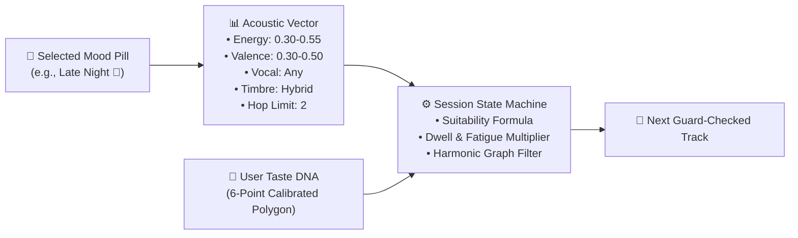

# 🎼 MusicMood: Category & Pill Functional Matrix

> **Official Technical Specification & Behavioral Architecture**  
> *Version:* 1.0 (Milestone 16 / Engine v0.6.0)  
> *Status:* **Ratified & Active**

---

## 🌟 Executive Summary

In MusicMood, the **Headspace Pills** do not act as static playlist labels or simplistic search keywords. Instead, each pill functions as an **acoustic steering vector** that dynamically adjusts the Session State Machine's candidate scoring, harmonic traversal boundaries, vocal constraints, and fatigue dampeners while respecting the user's calibrated Taste DNA polygon.



---

## 🎛️ Mathematical Dimension Definitions

Each of the 30 pills is parameterized across 7 objective acoustic dimensions:

$$\text{PillVector} = \langle E, V, \text{Vocal}, \text{Timbre}, \text{BPM}, H, \mu_{\text{fatigue}} \rangle$$

| Dimension | Domain | Description | Engine Impact |
|---|---|---|---|
| **Energy ($E$)** | $[0.0, 1.0]$ | Perceived musical intensity, dynamic loudness, percussion aggression. | Filters candidate track tempo, density, and production style. |
| **Valence ($V$)** | $[0.0, 1.0]$ | Musical positiveness, emotional warmth, harmonic mode (minor vs. major). | Steers chord voicings (e.g. minor 7ths for Sad/Rainy vs. major 9ths for Happy/Hopeful). |
| **Vocal Policy** | Enum | Vocal presence constraint (`instrumental_strict`, `instrumental_preferred`, `vocal_prominent`, `any`). | Hard filter on vocal metadata and title heuristics (e.g. Instrumental, STEM, Karaoke tags). |
| **Timbre** | Enum | Sonic palette (`acoustic`, `synthetic`, `electric`, `hybrid`, `ambient`). | Guides JIT search terms and candidate classification. |
| **Target BPM** | $[\text{min}, \text{max}]$ | Recommended tempo envelope in beats per minute. | Rhythmic synchronization with heart rate or activity cadence. |
| **Hop Limit ($H$)** | $\{1, 2, \infty\}$ | Maximum graph distance from the user's calibrated anchors in `TASTE_GRAPH_EDGES`. | $H=1$ locks tightly to familiar nodes; $H=2$ allows natural cluster exploration. |
| **Fatigue Multiplier ($\mu$)** | $[0.3, 1.5]$ | Acceleration factor for genre satiation: $\text{Fatigue}_{t+1} = \text{Fatigue}_t + (\Delta \times \mu)$. | High $\mu$ forces rapid variety (Party); low $\mu$ sustains deep continuous flow (Focus/Ambient). |

---

## 🏛️ The 5 Tonal Categories

```
[ ✨ Core ]          →  Foundational Emotional Anchors (Everyday emotional baseline)
[ 🏃 Activities ]    →  Functional & Contextual Sessions (Tied to physical/cognitive tasks)
[ 🎨 Nuances ]       →  Emotional Micro-Climates (Bittersweet, complex, and lyrical states)
[ 🔮 Aesthetics ]    →  Subcultural Timbral Tropes (Internet subcultures & stylistic personas)
[ 🎬 Cinematic ]     →  Atmospheric Narrative Soundscapes (World-building & cinematic textures)
```

---

## 📊 Complete 30-Pill Master Matrix

### 1. ✨ Core Headspaces (Foundational Emotions)

| Pill | Emoji | Energy ($E$) | Valence ($V$) | Vocal Policy | Timbre | Target BPM | Hop ($H$) | Fatigue ($\mu$) | Primary Genre Associations | Behavioral Description |
|---|:---:|:---:|:---:|---|---|:---:|:---:|:---:|---|---|
| **Happy** | 😊 | $0.65 - 0.85$ | $0.75 - 1.00$ | `vocal_prominent` | `hybrid` | $110 - 130$ | 2 | 1.0 | Pop, Funk, Neo-Soul, Disco, Uplifting Indie | High danceability, infectious hooks, major-key harmony, feel-good bounce. |
| **Sad** | 😢 | $0.15 - 0.40$ | $0.05 - 0.30$ | `any` | `acoustic` | $60 - 85$ | 1 | 0.8 | Indie Folk, Slow Blues, Chamber Pop, Melancholic Ballads | Intimate acoustics, minor/dorian scales, felt piano, tender vulnerable vocals. |
| **Chill** | 🧘 | $0.30 - 0.50$ | $0.45 - 0.65$ | `any` | `hybrid` | $75 - 95$ | 2 | 0.7 | Lofi Hip-Hop, Downtempo, Smooth Jazz, Chillwave | Laid-back swing, warm low-end bass, relaxed pacing, unhurried ease. |
| **Energetic** | ⚡ | $0.80 - 1.00$ | $0.50 - 0.80$ | `any` | `electric / synthetic` | $128 - 174$ | 2 | 1.2 | Electro House, Synthwave, Hard Rock, Drum & Bass | Punchy transients, driving rhythm sections, motivational athletic momentum. |
| **Focus** | 🧠 | $0.30 - 0.50$ | $0.40 - 0.60$ | `instrumental_strict` | `hybrid` | $80 - 110$ | 1 | 0.6 | Neoclassical, Minimalist Ambient, Lofi Beats, IDM | Zero vocal distraction, unvarying steady pulse, cognitive flow optimization. |
| **Party** | 🎉 | $0.75 - 0.95$ | $0.70 - 0.90$ | `vocal_prominent` | `synthetic` | $120 - 132$ | 2 | 1.4 | Hip-Hop/Rap, Tech House, Latin Pop, Nu-Disco | Four-on-the-floor kicks, call-and-response hooks, crowd-energizing hype. |

---

### 2. 🏃 Activities (Functional Contexts)

| Pill | Emoji | Energy ($E$) | Valence ($V$) | Vocal Policy | Timbre | Target BPM | Hop ($H$) | Fatigue ($\mu$) | Primary Genre Associations | Behavioral Description |
|---|:---:|:---:|:---:|---|---|:---:|:---:|:---:|---|---|
| **Morning Boost** | 🌅 | $0.50 \rightarrow 0.70$ | $0.65 - 0.85$ | `any` | `acoustic` | $95 - 118$ | 2 | 1.0 | Morning Indie, Bossa Nova, Motown Soul, Acoustic Pop | Rising energy curve, bright acoustic guitar/keys, sunrise optimism. |
| **Study** | 📚 | $0.25 - 0.45$ | $0.40 - 0.60$ | `instrumental_strict` | `hybrid` | $70 - 90$ | 1 | 0.5 | Ambient Piano, Chillhop, Modular Drones, Neoclassical | Low dynamic variance, non-intrusive frequency spectrum, zero vocal bleed. |
| **Workout** | 💪 | $0.85 - 1.00$ | $0.40 - 0.75$ | `any` | `electric / synthetic` | $130 - 165$ | 2 | 1.3 | Metalcore, Industrial, Hardstyle, Hype Trap | Peak sustained BPM, visceral drops, heavy low-end compression, adrenaline surge. |
| **Roadtrip** | 🚗 | $0.60 - 0.80$ | $0.60 - 0.85$ | `vocal_prominent` | `hybrid` | $100 - 124$ | 2 | 0.9 | Classic Rock, Americana, Heartland Rock, Indie Anthems | Motoring tempo, singalong choruses, forward driving rhythm, open-road freedom. |
| **Rainy Day** | 🌧️ | $0.20 - 0.45$ | $0.25 - 0.45$ | `any` | `acoustic` | $65 - 85$ | 1 | 0.7 | Acoustic Blues, Cool Jazz, Coffeehouse Folk, Post-Rock | Warm room reverb, vinyl crackle, introspective minor chords, comforting gloom. |
| **Late Night** | 🌃 | $0.30 - 0.55$ | $0.30 - 0.50$ | `any` | `hybrid` | $70 - 95$ | 2 | 0.8 | Dark Jazz, Trip-Hop, Vaporwave, Nocturnal R&B | Sub-bass heavy, nocturnal neon atmosphere, smoking-room lounge feel. |
| **Wind Down** | 🌙 | $0.05 - 0.25$ | $0.40 - 0.60$ | `instrumental_strict` | `acoustic / ambient` | $45 - 65$ | 1 | 0.4 | Weightless Ambient, Sleep Drone, Soft Harp, Neoclassical | Zero abrupt drums, time-dilated decay, parasympathetic nervous system calming. |

---

### 3. 🎨 Nuances (Emotional Micro-Climates)

| Pill | Emoji | Energy ($E$) | Valence ($V$) | Vocal Policy | Timbre | Target BPM | Hop ($H$) | Fatigue ($\mu$) | Primary Genre Associations | Behavioral Description |
|---|:---:|:---:|:---:|---|---|:---:|:---:|:---:|---|---|
| **Nostalgic** | 📼 | $0.40 - 0.65$ | $0.45 - 0.70$ | `vocal_prominent` | `hybrid` | $85 - 115$ | 2 | 1.0 | 80s Synthpop, 70s Soft Rock, 90s Alt-Rock, Oldies Soul | Analog tape warmth, chorused guitars, vintage synth tones, bittersweet memories. |
| **Romantic** | 💖 | $0.35 - 0.60$ | $0.60 - 0.80$ | `vocal_prominent` | `acoustic` | $68 - 92$ | 2 | 0.9 | Neo-Soul, Slow Jam R&B, Romantic Classical, Chanson | Lush string arrangements, sensual mid-tempo groove, intimate breathy vocals. |
| **Melancholic** | 🥀 | $0.20 - 0.40$ | $0.10 - 0.35$ | `any` | `acoustic` | $55 - 80$ | 1 | 0.7 | Slowcore, Sadcore, Cello Solos, Dark Folk, Post-Rock | Poetic sorrow, spacious room to feel and reflect, cello and piano emphasis. |
| **Hopeful** | 🌱 | $0.50 - 0.75$ | $0.70 - 0.90$ | `any` | `hybrid` | $88 - 120$ | 2 | 1.0 | Cinematic Folk, Post-Rock Crescendos, Uplifting Choral | Dynamic crescendos building from quiet solitude to soaring triumphant resolutions. |
| **Dark / Intense** | 🌑 | $0.70 - 0.95$ | $0.10 - 0.30$ | `any` | `electric / synthetic` | $100 - 145$ | 2 | 1.1 | Darksynth, Gothic Rock, Doom Metal, Industrial Techno | High harmonic tension, minor/diminished scales, brooding psychological weight. |
| **Dreamy** | ☁️ | $0.30 - 0.55$ | $0.50 - 0.70$ | `any` | `hybrid` | $75 - 105$ | 2 | 0.7 | Shoegaze, Dream Pop, Ambient Electronic, Ethereal Wave | Washed-out reverb tails, shimmering tremolos, surreal out-of-body float. |

---

### 4. 🔮 Aesthetics (Internet Subcultures & Timbral Tropes)

| Pill | Emoji | Energy ($E$) | Valence ($V$) | Vocal Policy | Timbre | Target BPM | Hop ($H$) | Fatigue ($\mu$) | Primary Genre Associations | Behavioral Description |
|---|:---:|:---:|:---:|---|---|:---:|:---:|:---:|---|---|
| **Main Character** | ✨ | $0.70 - 0.85$ | $0.65 - 0.85$ | `vocal_prominent` | `synthetic` | $115 - 128$ | 2 | 1.1 | Indie Pop Anthems, Euphoric Electronic, Art Pop | Swelling anthems that make everyday walking feel like the climax of a movie. |
| **Villain Mode** | 😈 | $0.70 - 0.90$ | $0.20 - 0.40$ | `any` | `synthetic / electric` | $130 - 150$ | 2 | 1.2 | Dark Trap, Phonk, Midtempo Cyber-Bass, Grime | Sinister half-time swagger, menacing sub-bass, distorted 808s, dark attitude. |
| **Soft Vibes** | 🧸 | $0.25 - 0.45$ | $0.60 - 0.80$ | `any` | `acoustic` | $72 - 92$ | 2 | 0.8 | Bedroom Pop, Cute Lofi, Indie Ukulele, Soft Acoustic | Delicate acoustic guitar, felt piano, pastel aesthetic, gentle cozy warmth. |
| **Dark Academia** | 🏛️ | $0.35 - 0.60$ | $0.30 - 0.50$ | `instrumental_preferred` | `acoustic` | $60 - 100$ | 1 | 0.7 | Baroque, Romantic Era Classical, Solo Violin, Dark Jazz | Candlelit library atmosphere, literary romance, virtuoso chamber counterpoint. |
| **Cottagecore** | 🍄 | $0.35 - 0.60$ | $0.65 - 0.85$ | `any` | `acoustic` | $80 - 112$ | 2 | 0.9 | Traditional Folk, Celtic Instrumental, Acoustic Bluegrass | Acoustic mandolins, wooden flutes, earthy pastoral storytelling, forest calm. |
| **Cyberpunk** | 🤖 | $0.75 - 0.95$ | $0.25 - 0.50$ | `any` | `synthetic` | $110 - 135$ | 2 | 1.2 | Darksynth, EBM, Industrial Cyber, Neo-Tokyo Electro | Neon-drenched arpeggios, mechanical rhythm precision, dystopian grit. |

---

### 5. 🎬 Cinematic (Narrative & World-Building Soundscapes)

| Pill | Emoji | Energy ($E$) | Valence ($V$) | Vocal Policy | Timbre | Target BPM | Hop ($H$) | Fatigue ($\mu$) | Primary Genre Associations | Behavioral Description |
|---|:---:|:---:|:---:|---|---|:---:|:---:|:---:|---|---|
| **Epic** | ⚔️ | $0.80 - 1.00$ | $0.50 - 0.75$ | `instrumental_preferred` | `hybrid` | $90 - 140$ | 2 | 1.1 | Orchestral Trailer, Hybrid Symphonic, Battle Scores | Taiko thunder, massive brass fanfares, soaring choirs, high dynamic trailer sound. |
| **Mystery / Noir** | 🕵️ | $0.25 - 0.50$ | $0.25 - 0.45$ | `instrumental_strict` | `acoustic` | $60 - 85$ | 1 | 0.7 | Noir Jazz, Dark Ambient Strings, Suspense Underscore | Muted trumpet cries, walking upright bass in shadows, unresolved chord tensions. |
| **Fantasy** | 🧝 | $0.40 - 0.70$ | $0.55 - 0.80$ | `any` | `acoustic` | $75 - 115$ | 2 | 0.8 | Celtic Orchestral, Medieval Tavern, Enchanted Forest | Bodhrán pulses, Celtic harps, tavern ambiance, mythical enchanted forest escapism. |
| **Sci-Fi** | 🛸 | $0.40 - 0.70$ | $0.35 - 0.60$ | `instrumental_strict` | `synthetic` | $65 - 105$ | 2 | 0.7 | Space Ambient, Modular Electronic, Vangelis Synth | Cosmic sub-harmonics, modular synths, interstellar expanse, futuristic electronic. |
| **Ambient** | 🌫️ | $0.05 - 0.30$ | $0.40 - 0.60$ | `instrumental_strict` | `synthetic / ambient` | $40 - 70$ | 1 | 0.3 | Drone, Soundscape, Generative Music, Field Recordings | Beatless floating textures, generative pads, infinite reverberation, pure atmosphere. |

---

## 🛠️ Engine Implementation Blueprint

```javascript
// Example candidate scoring function using the Mood Matrix:
function calculateMoodCandidateScore(candidateTrack, activeMoodVector, userTasteDNA) {
    // 1. Vocal Invariant Check
    if (activeMoodVector.vocalPolicy === 'instrumental_strict' && candidateTrack.hasVocals) {
        return 0; // Hard rejection
    }

    // 2. Acoustic Parameter Proximity
    const energyDelta = Math.abs(candidateTrack.energy - (activeMoodVector.energy[0] + activeMoodVector.energy[1]) / 2);
    const valenceDelta = Math.abs(candidateTrack.valence - (activeMoodVector.valence[0] + activeMoodVector.valence[1]) / 2);
    const acousticFit = 1.0 - (energyDelta * 0.5 + valenceDelta * 0.5);

    // 3. User Taste DNA Conformance
    const tasteWeight = userTasteDNA[candidateTrack.genreFamily] || 0.5;

    // 4. Harmonic Graph Penalty
    const hopDistance = getHarmonicGraphDistance(candidateTrack.genre, activeMoodVector.defaultGenre);
    const graphPenalty = hopDistance > activeMoodVector.harmonicHopLimit ? 0.3 : 1.0;

    return acousticFit * tasteWeight * graphPenalty;
}
```

---

## 🔮 Future Extension: "Ask AI What You Want"
The parameter schema defined in this matrix serves as the exact semantic target for the upcoming **"Ask AI What You Want"** conversational intent parser. When a user provides natural language input (e.g. *"dark moody jazz in the rain with no vocals"*), the parser maps the prompt directly into this vector structure:
* `energyRange: [0.20, 0.45]`
* `valenceRange: [0.25, 0.45]`
* `vocalPolicy: "instrumental_strict"`
* `timbre: "acoustic"`
* `primaryGenre: "jazz"`
* `dealbreakers: ["screaming", "upbeat"]`

This enables freeform conversational requests to interface directly with the mathematical Session State Machine while maintaining 100% authentic human music integrity.
