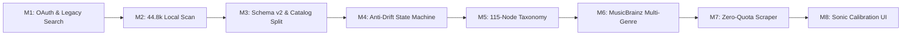

# 📜 MusicMood — Comprehensive Features & Architecture

This document tracks the technical specifications, development milestones, and behavioral rules that govern the **MusicMood** application.

---

## 🏛️ Development Milestones & Feature History

---

### Milestone 1: YouTube OAuth & Foundation Discovery (v0.1.0)
* **OAuth 2.0 User Auth:** Implicit/AuthCode flow targeting Google Identity and YouTube Data API v3 (`auth.js`).
* **Profile & Playlist Sync:** Fetched user name, avatar, and existing public/private YouTube playlists for quick start.
* **Basic Mood Search:** Early prototype mapping simple moods (*Happy*, *Sad*, *Energetic*) to search query strings sent to YouTube's search endpoint.

---

### Milestone 2: Local Library Scanning & 44.8k Cloud Sync (v0.2.0)
* **Massive File Scanner:** Node.js pipeline (`scripts/scanLibrary.js`) recursively traversing local storage (e.g. `M:\Music`) for audio files (`.mp3`, `.flac`, `.m4a`, `.wav`, `.ogg`).
* **Audio Tag Extraction:** Deep inspection using `music-metadata` to extract ID3v2, Vorbis, and parent directory heuristics.
* **44,885 Song Archive:** Synchronized the entire personal library to Supabase PostgreSQL table `public.local_metadata`.
* **Cyrillic & Mojibake Healing:** Automatic detection and repair of Windows-1251/CP1252 character corruption on classic/foreign artist titles.

---

### Milestone 3: Schema v2 Architecture & Separation of Concerns (v0.3.0)
* **Catalog Decoupling:** Separated raw local file entries (`public.local_metadata`) from playable, verified YouTube streams (`public.tracks`).
* **Normalized Artists Table:** Created `public.artists` with unique constraints, MusicBrainz identifiers (`mbid`), primary genres, and disambiguation.
* **Foreign Key Relational Integrity:** Linked 44,000+ tracks to artists via indexed `artist_id` foreign keys with `ON DELETE SET NULL`.
* **Multi-Genre Arrays:** Implemented PostgreSQL native `text[]` arrays (`secondary_genre_ids`) with GIN indexing for multi-genre filtering.

---

### Milestone 4: Anti-Drift Session State Machine (v0.4.0)
* **Mathematical Invariant Guards:**
  - **Node Dwell Limit:** Strictly caps playback in a single subgenre to 2 consecutive tracks before automatically shifting along harmonic graph edges.
  - **Artist Satiation Cooldown:** Maintains a 15-artist sliding window to prevent repetition of the same band or singer.
  - **Track History De-duplication:** 50-track exclusion buffer to prevent immediate replay loops.
* **Real-Time Steering Engine:**
  - **Dynamic Fatigue:** Each play in a genre accumulates fatigue penalty: $\text{Suitability} = \text{Affinity} \times (1 - \text{Fatigue}) \times \text{HarmonicProximity}$.
  - **Discovery Radius:**
    - *Familiar (0.2):* Anchored exclusively to 1-hop harmonic neighbors and user favorites.
    - *Balanced (0.5):* Expands to 1-hop and 2-hop harmonic neighbors + mood-compatible clusters.
    - *Deep Cuts (0.85):* Traverses anywhere in the graph outside user dealbreakers.
* **Dealbreaker Filter:** Instant candidate rejection based on negative sound attributes (e.g., *No Mumble Rap*, *No Harsh Growls*, *No Commercial Festival EDM*, *No Bro-Country*).

---

### Milestone 5: 115-Node Canonical Music Taxonomy (v0.4.5)
* **14 Major Genre Families:**
  - `rock`, `metal`, `electronic`, `pop`, `hip_hop`, `rnb_soul`, `jazz`, `blues`, `classical`, `folk_acoustic`, `country`, `world_reggae`, `ambient_chill`, `avant_garde`.
* **17 Umbrella Parent Genres:** Enabled top-level exploration for users who do not know obscure subgenres (e.g., choosing `rock` or `classical` directly).
* **98 Granular Subgenres:** RYM/AllMusic-compliant subgenres with curated energy ratings, default vocal tendencies (*Instrumental*, *Vocal*, *Any*), and harmonic graph transition edges in `TASTE_GRAPH_EDGES`.
* **100% Catalog Normalization:** Every track in `public.tracks` maps to a canonical ID from this taxonomy.

---

### Milestone 6: MusicBrainz Community Multi-Genre Integration (v0.4.8)
* **MetaBrainz Authority:** Switched from fragile regex guessing to the open, non-profit MusicBrainz API (`https://musicbrainz.org/ws/2/`).
* **Multi-Genre Tag Extraction:** Extracts community-voted genre tags and weights them by vote count.
* **Multi-Genre Bands:** Accurately classifies artists that span multiple sounds (e.g., *Dead Can Dance* $\rightarrow$ `synthwave` + `[rock, new_age, post_punk, ambient, classical]`).
* **Batch Artist Reconciliation Script:** [`scripts/enrichArtistsFromMusicBrainz.js`](file:///c:/Visual%20studio/MusicMood/scripts/enrichArtistsFromMusicBrainz.js) reconciles distinct artists, updates `public.artists`, and automatically cascades the canonical tags to all songs by that artist.
* **Rate-Limit Compliance:** Built-in 1,100ms request queue with 503 backoff retries respecting the MetaBrainz foundation policy.

---

### Milestone 7: Zero-Quota Scraper & Playback Resilience (v0.5.0)
* **Zero-Quota YouTube Playlist Ingester:** Ingests user playlists and extracts video IDs without burning daily Google Cloud Data API quotas.
* **Anti-Bot & Cookie Consent Bypass:** Hardened HTML scraper with `SOCS` cookie bypass headers and index-based `ytInitialData` extraction.
* **Strict Verification:** Filters out multi-hour compilations, STEM tracks, live interview podcasts, and game walkthroughs using duration bounds and channel verification.
* **Fail-Safe Sourcing Waterfall:**
  - **Tier A (Strict):** Guard-checked track within active genre and 15-artist cooldown.
  - **Tier B (Relaxed):** Relaxes cooldown if genre has limited artists (avoiding only current track).
  - **Tier C (Emergency Catalog):** Draws from the 4,326 verified tracks to guarantee 0% dropout rate.
* **Non-Destructive Downvote:** Thumbs-down button records personal feedback in `listening_history`, blacklists the artist for the session, and nudges the graph without deleting global database mappings.

---

### Milestone 8: Sonic Calibration & Minimalist UI (v0.5.0)
* **Sonic Calibration Wizard:**
  - 1-click **"✨ Calibrate from Library"** scans user's 44,885 tracks to calculate exact genre affinity weights.
  - Interactive grid displaying all 115 genres with family tags.
  - Dealbreaker toggles with transparent acoustic rationale.
* **Low-Friction Player Controls:**
  - Single **Energy Slider** (0% to 100%).
  - **Vocal Mode Switcher** (*Any*, *Instrumental Only*, *Vocals*).
  - **Discovery Tier Toggles** (*Familiar*, *Balanced*, *Deep Cuts*).
  - **Family-Grouped Active Node Selector:** `<select>` with `<optgroup>` for all 115 genres.
  - Cluttered Nuance/Situation dropdowns tucked away to keep the interface fast and clean.

---

## 🔮 Feature Backlog (Upcoming Roadmap)

### 1. Universal YouTube Library Taste Profiler (Refactor "Calibrate from Library")
* **Current Bottleneck:** The current "Calibrate from Library" scans `public.local_metadata` which is hardcoded to the local developer SMB archive (`\\192.168.0.2\e$\music`), making it useless for any other user.
* **Universal Refactoring:**
  - Connect to user's authentic **YouTube Music Liked Videos & Playlists** (or allow public playlist URL / M3U import).
  - Pipe ingested artists and tracks through `genreNormalizer.js` and MusicBrainz to calculate personal genre affinity weights, dealbreakers, and anchors per user.
  - Multi-tenant storage in `public.user_profiles.taste_weights` keyed by `user_id`.
  - Provide an interactive 60-second "Pick 5 Favorite Artists" onboarding fallback for guest/unconnected users.
  - Relegate local file directory scanning (`scanLibrary.js`) to an optional "Power User / Self-Hosted NAS" feature in Settings.

### 2. Artist Finder & Favorites
* **Search & Autocomplete:** Search for any artist across the 44.8k archive and 4.3k verified catalog.
* **Artist Profile View:** View an artist's MusicBrainz tags, biography, discography in the library, and primary genres.
* **Favorite Toggle:** Star an artist to increase their base affinity weight in the state machine without restricting discovery.

### 3. Experimental: YouTube "MusicMood Favorites" Auto-Sync
* **One-Click Favorite:** Liking a track with ❤️ can optionally append that video ID directly to a dedicated playlist titled `"MusicMood Favorites"` in the user's authentic YouTube account.
* **Overwriting Protection:** Uses single-playlist append-only mode to prevent overwriting or deleting any of the user's pre-existing YouTube playlists.

### 4. User-Selected Localized / Regional Music
* **Optional Language Filter:** Allow users to request music in specific languages (e.g., French, Romanian, Japanese, Spanish) on demand.
* **Non-Invasive:** Kept strictly outside the core engine defaults so regional music never plays unless explicitly chosen by the user.

---

## 📐 Key Specifications & Invariant Rules

| Metric | Specification | Rationale |
|---|---|---|
| **Max Node Dwell** | 2 tracks | Prevents falling into repetitive genre fatigue. |
| **Artist Cooldown** | 15 artists | Prevents artist over-representation in smaller subgenres. |
| **History Buffer** | 50 tracks | Prevents immediate track replaying during long sessions. |
| **Max Discovery Share** | 25% | Prevents a single anchor from monopolizing 100% of the session. |
| **Min Floor Share** | 5% | Guarantees room for serendipitous exploration. |
| **MusicBrainz Rate Limit** | 1.1s per request | Complies with MetaBrainz Foundation API policy. |
| **Catalog Fail-Safe** | 3-tier waterfall | 0% track dropout even during zero YouTube token conditions. |
