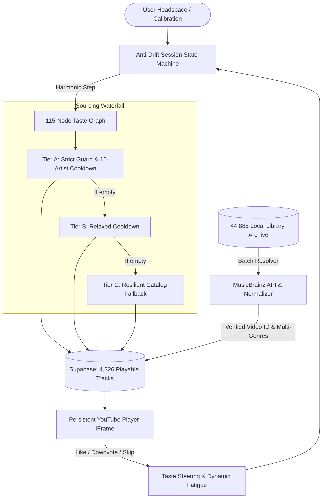

# 🎵 MusicMood

> **A mood-driven, anti-drift music exploration engine.**  
> Listen by headspace, explore across harmonic genre graphs, and eliminate algorithmic fatigue — with **zero Google YouTube Data API quota**.

[](https://vitejs.dev/)
[](https://react.dev/)
[](https://supabase.com/)
[](https://musicbrainz.org/)
[](package.json)

---

## 🌟 What is MusicMood?

Most commercial music algorithms suffer from **algorithmic drift**: after 3 songs, they trap you into the same 10 repetitive top-40 tracks or autoplay white noise.

**MusicMood** was built to solve this:
1. **Headspace First:** Choose your state (*Focus*, *Chill*, *Energetic*, *Melancholic*, *Late Night*, *Cyberpunk*, etc.).
2. **Anti-Drift Invariant Guards:** Enforces a 2-track node dwell limit, 15-artist satiation cooldown, and strict user dealbreaker exclusions (e.g. no mumble rap, no harsh screaming, no commercial festival EDM).
3. **Harmonic Taste Graph:** Traverses adjacent subgenres musically rather than randomly (e.g., *Prog Rock* $\rightarrow$ *Post-Rock* $\rightarrow$ *Shoegaze* $\rightarrow$ *Ambient*).
4. **Zero-Quota Engine:** Streams audio seamlessly through an invisible, persistent YouTube player while drawing candidates from a verified 4,300+ track Supabase catalog and a 44,800+ personal library archive without consuming Google API quotas.
5. **Community-Grade Metadata:** Enriched with canonical multi-genre classifications directly from the **MetaBrainz Foundation (MusicBrainz)**.

---

## 🏗️ System Architecture



---

## 🚀 Key Features

- **🛡️ Anti-Drift State Machine:** Mathematically prevents algorithm fatigue using dynamic node fatigue penalties and configurable discovery radii (*Familiar*, *Balanced*, *Deep Cuts*).
- **🎼 115 Canonical Genres across 14 Families:** Structured ontology covering all major eras and subgenres (Rock, Metal, Electronic, Jazz, Classical, Blues, Folk, etc.) with harmonic transition edges.
- **🏷️ MusicBrainz Multi-Genre Tagging:** Artists and songs carry primary genre anchors plus rich secondary genre arrays (`secondary_genre_ids: text[]`), capturing multi-genre bands accurately.
- **✨ 1-Click Sonic Calibration Wizard:** Analyzes your personal 44.8k library archive to calculate your musical DNA and automatically anchor your preferences.
- **🎛️ Minimalist Real-Time Steering:** Streamlined single-slider energy control, vocal mode toggles (*Any*, *Instrumental Only*, *Vocals*), and a 1-click active genre dropdown grouped by family.
- **👎 Non-Destructive Personal Downvoting:** Disliking a song blacklists the artist for your current session and steers the graph away without damaging global database mappings.

---

## 📦 Getting Started

### 1. Prerequisites
- **Node.js** v18+ (tested on Node v20+)
- **Supabase Project** (PostgreSQL with `pgvector` or standard tables)

### 2. Installation
```bash
# Clone the repository
git clone https://github.com/corneliunitoi/MusicMood.git
cd MusicMood

# Install dependencies
npm install
```

### 3. Environment Setup
Create a `.env` file in the root directory:
```env
VITE_SUPABASE_URL=https://your-project.supabase.co
VITE_SUPABASE_ANON_KEY=your-supabase-anon-key
VITE_YOUTUBE_CLIENT_ID=your-google-oauth-client-id
```

### 4. Running the Development Server
```bash
npm run dev
```
Open [http://localhost:5173](http://localhost:5173) in your browser.

---

## 🛠️ CLI Utilities & Catalog Scripts

MusicMood includes a suite of background maintenance and catalog expansion scripts:

| Command | Description |
|---|---|
| `npm run build` | Compiles and verifies the production Vite bundle. |
| `npm run resolve-library` | Resolves tracks from `local_metadata` to verified YouTube IDs. |
| `npm run resolve-library:random` | Resolves random diverse tracks from your 44.8k archive into the playable catalog. |
| `npm run enrich-genres` | Queries MusicBrainz to enrich top artists and songs with multi-genre tags. |
| `npm run enrich-genres:all` | Performs a full sweep across all un-enriched artists in the database. |
| `npm run scan-library` | Recursively scans a local audio directory (e.g. `M:\Music`) into Supabase. |

---

## 📊 Database Schema (v2)

- **`public.tracks`**: Curated playable tracks with verified `youtube_video_id`, `primary_genre_id`, `secondary_genre_ids` (`text[]`), `artist_id`, and `energy`.
- **`public.artists`**: Canonical artists with MusicBrainz MBID, primary genre, tags, and disambiguation.
- **`public.local_metadata`**: Full 44,885+ song archive from personal libraries, tracking local paths and mapping resolution status.
- **`public.listening_history`**: User playback events, dwell durations, like/downvote telemetry, and skip statistics.

---

## 📄 Documentation

- [FEATURES.md](FEATURES.md) — Detailed feature specifications, development history, and architectural milestones.
- [ROADMAP.md](ROADMAP.md) — Prioritized roadmap, custom mood defaults, and upcoming features.

---

## 📄 License

Private / Personal Project. All rights reserved.
