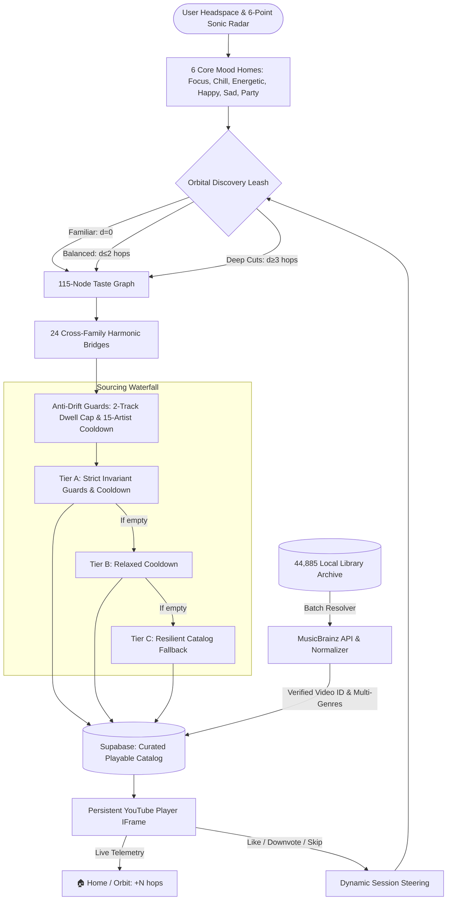

# 🎵 MusicMood

> **A mood-driven, anti-drift music exploration engine.**  
> Listen by headspace, explore across harmonic genre graphs, and eliminate streaming fatigue — with **zero Google YouTube Data API quota**.

[](https://vitejs.dev/)
[](https://react.dev/)
[](https://supabase.com/)
[](https://musicbrainz.org/)
[](package.json)
[](RELEASE_MANAGEMENT.md)

---

## 🌟 What is MusicMood?

Most commercial streaming algorithms suffer from **algorithmic fatigue** and **drift**: after three songs, they trap you into the same five repetitive top-40 tracks or devolve into generic background noise.

**MusicMood** was built to hand control back to the listener:

1. **You Steer, Not the Black Box:** We built MusicMood to eliminate streaming fatigue. The player constantly rotates artists and styles in the background so you never get trapped hearing the same five songs on repeat.
2. **Headspace First:** Choose your mood (*Focus*, *Chill*, *Energetic*, *Happy*, *Sad*, *Party*). Each mood is anchored to a personalized **Home Genre** calibrated to your musical taste.
3. **Orbital Discovery Leash:** Explore safely away from your home base with 3 discovery tiers:
   - **Familiar (0.2):** Strict leash locked to your Home subgenre.
   - **Balanced (0.5):** Smooth harmonic transitions within 2 hops of your Home.
   - **Deep Cuts (0.85):** Unrestricted adventurous traversal across compatible genre families.
4. **Instant Variety on Demand ("Surprise Me"):** Ready for something different? One tap leaps to a fresh genre that naturally fits your flow—no jarring tempo drops, no mood killers.
5. **Zero-Quota Engine:** Streams audio seamlessly through an invisible, persistent YouTube player while drawing candidates from a verified Supabase catalog and your personal library archive without consuming Google API quotas.
6. **Community-Grade Metadata:** Enriched with canonical multi-genre classifications directly from the **MetaBrainz Foundation (MusicBrainz)**.

---

## 🏗️ System Architecture



---

## 🚀 Key Features

### 🧭 6-Stop Interactive Guided Spotlight Tour
- **Live Interface Walkthrough:** Dims the screen and illuminates actual interface widgets in real time to guide new listeners through the app in under 60 seconds.
  1. `🎛️ Calibrate Taste`: 6-point sound polygon and dealbreaker exclusions.
  2. `📥 Ingest Playlists`: Zero-quota YouTube library synchronization.
  3. `🧠 Steer by Headspace`: 6 core moods anchored to personal home genres.
  4. `🎧 Music That Never Gets Stale`: Background artist rotation eliminating repetition.
  5. `🎲 Instant Variety on Demand`: Context-aware harmonic leaps on demand.
  6. `🧭 Discovery Horizon`: Leashed exploration tiers (Familiar, Balanced, Deep Cuts).
- **Persistent Header Access:** Launch the tour anytime via the `✨ How It Works` button in the header nav.
- **Configurable Startup Greeting:** Option 1 glassmorphic hero modal with an interactive `[x] Don't show this welcome screen on startup` preference toggle.

### 🏠 Calibrated Mood Homes & Orbital Deviation
- **6 Core Mood Anchors:** Focus, Chill, Energetic, Happy, Sad, and Party are each assigned a primary Home subgenre.
- **Predictive Step 3 Onboarding:** Evaluates your 6-point Sonic Radar DNA to pre-fill ideal Home Anchors across all 115 ontology genres in 14 families (`Metal`, `Rock`, `Electronic`, `Jazz`, `Classical`, etc.).
- **Live Orbital Telemetry:** Player header displays real-time deviation indicators (`🏠 Home` or `Orbit: +N hops`) as you traverse the graph.

### 🎲 Discovery-Governed "Surprise Me" Traversal
- **Dynamic Hop Leashing:** Clicking **Surprise Me** respects your active Discovery setting:
  - *Familiar:* Strictly leaps to 1-hop immediate neighbors or sister styles.
  - *Balanced:* Smooth transitions within 2 harmonic hops.
  - *Deep Cuts:* Unrestricted leaps to adventurous styles while preserving mood compatibility.
- **Dynamic Tooltips:** The button tooltip updates in real time to show active constraints (e.g., `Surprise Me (Balanced: ≤ 2-hop jump)`).

### 🌉 24 Harmonic Cross-Genre Bridges
- Eliminates isolated dead-ends across the 115-node graph with dual-direction canonical bridges connecting Dance, Electronic, Metal, Classical, Ambient, Blues, and Jazz.

### 🎛️ 6-Point Sonic Radar & Supabase Cloud Persistence
- Sculpt your acoustic DNA across 6 poles (`Rock/Metal`, `Electronic`, `Hip-Hop/Soul`, `Jazz/Blues`, `Folk/Acoustic`, `Classical/Ambient`).
- Preferences, anchors, and dealbreakers automatically synchronize via Supabase across desktop, tablet, and mobile devices.

### 📥 Zero-Quota YouTube Playlist Ingestion
- Authenticate via Google Identity Services (GIS) popup OAuth and sync personal YouTube playlists without consuming Google YouTube Data API quotas.

### 🛡️ Non-Destructive Downvoting & Artist Satiation
- Disliking a track blacklists the artist for your active session and steers the graph away without altering global database mappings.

---

## 📦 Getting Started

### 1. Prerequisites
- **Node.js** v20+ (recommended)
- **Supabase Project** (PostgreSQL with `pgvector` or standard relational tables)
- **Google OAuth Client ID** (for YouTube playlist synchronization)

### 2. Installation
```bash
# Clone the repository
git clone https://github.com/corneliunitoi/MusicMood.git
cd MusicMood

# Install dependencies
npm install
```

### 3. Environment Setup
Create a `.env` file in the root directory:
```env
VITE_SUPABASE_URL=https://your-project.supabase.co
VITE_SUPABASE_ANON_KEY=your-supabase-anon-key
VITE_YOUTUBE_CLIENT_ID=your-google-oauth-client-id
```

### 4. Running the Development Server
```bash
npm run dev
```
Open [http://localhost:5173](http://localhost:5173) in your browser.

---

## 🛠️ CLI Utilities & Catalog Scripts

| Command | Description |
|---|---|
| `npm run build` | Compiles and verifies the production Vite bundle. |
| `npm run preview` | Previews the compiled production build locally. |
| `npm run start` | Launches the production standalone Node server with SPA routing. |
| `npm run tag-release <tag>` | Extracts release notes from `RELEASE_MANAGEMENT.md` and applies them to an annotated git tag. |
| `npm run extract-release-notes [tag]` | Outputs formatted changelog notes for any version tag. |
| `npm run resolve-library` | Resolves tracks from `local_metadata` to verified YouTube IDs. |
| `npm run resolve-library:random` | Resolves random diverse tracks from your 44.8k archive into the playable catalog. |
| `npm run enrich-genres` | Queries MusicBrainz to enrich top artists and songs with multi-genre tags. |
| `npm run enrich-genres:all` | Performs a full sweep across all un-enriched artists in the database. |
| `npm run scan-library` | Recursively scans a local audio directory (e.g. `M:\Music`) into Supabase. |

---

## 📊 Database Schema (v2)

- **`public.tracks`**: Curated playable tracks with verified `youtube_video_id`, `primary_genre_id`, `secondary_genre_ids` (`text[]`), `artist_id`, and `energy`.
- **`public.artists`**: Canonical artists with MusicBrainz MBID, primary genre, tags, and disambiguation.
- **`public.user_profiles`**: User identities, RBAC roles (`admin`, `poweruser`, `regular`), and JSONB `calibration` storing Sonic Radar profiles.
- **`public.local_metadata`**: Full 44,885+ song archive from personal libraries, tracking local paths and mapping resolution status.
- **`public.listening_history`**: User playback events, dwell durations, like/downvote telemetry, and skip statistics.

---

## 🏷️ Releases & Versioning

MusicMood follows a strict versioning protocol documented in [RELEASE_MANAGEMENT.md](RELEASE_MANAGEMENT.md):
- **Hotfixes & Patches:** `0.7.2a`, `0.7.2b`...
- **Feature Additions:** `0.7.3`, `0.8.0`...
- **Git Tags:** Always prefixed with lowercase `v` (e.g., `v0.7.2a`).

### Viewing Release Notes:
- **In Git CLI:** Run `git show v0.7.2a` to inspect the full multi-line changelog embedded in the annotated tag.
- **On GitHub:** Every pushed `v*` tag triggers an automated GitHub Actions release workflow that publishes the formatted Markdown release notes directly to [GitHub Releases](https://github.com/corneliunitoi/MusicMood/releases).

---

## 📄 Documentation

- [RELEASE_MANAGEMENT.md](RELEASE_MANAGEMENT.md) — Complete release protocol, versioning standard, and historical changelog.
- [FEATURES.md](FEATURES.md) — Detailed feature specifications, development history, and architectural milestones.
- [ROADMAP.md](ROADMAP.md) — Prioritized roadmap, custom mood defaults, and upcoming milestones.

---

## 📄 License

Private / Personal Project. All rights reserved.
