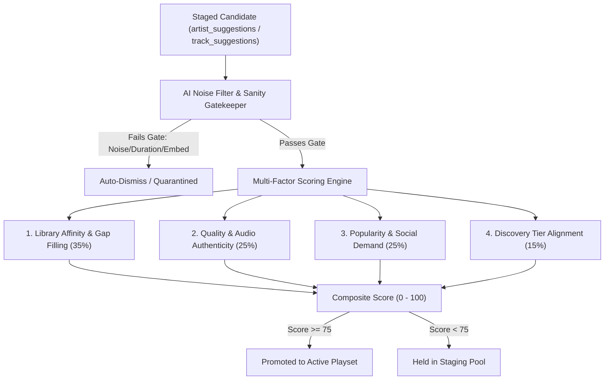

# 🗺️ MusicMood Strategic Roadmap

This document outlines prioritized enhancements, user experience improvements, and upcoming architectural milestones for **MusicMood**.

---

## 🎯 High Priority (Next Milestone — v0.6.1)

### 1. 🎛️ Custom Default Subgenres per Mood (Core 6 Moods)
* **Problem:** Clicking a mood (such as *Party* or *Happy*) currently routes to a hardcoded genre cluster (`MOOD_GENRE_MAP`), often defaulting to genres the user rarely listens to (e.g. `funk` or `classic_soul`). Listeners must manually select their preferred genre each time.
* **Scope:**
  * Allow listeners to define and persist their preferred starting subgenre for at least the **6 core moods**:
    1. 😊 **Happy** (e.g., *Indie Pop*, *Dance-Pop*, *Bluegrass*, *Bossa Nova*)
    2. 😢 **Sad** (e.g., *Singer-Songwriter*, *Post-Rock*, *Delta Blues*)
    3. 🧘 **Chill** (e.g., *Lofi Hip-Hop*, *Neo-Soul*, *Chillout House*)
    4. ⚡ **Energetic** (e.g., *Synthwave*, *Hard Rock*, *Drum & Bass*)
    5. 🧠 **Focus** (e.g., *Neo-Classical*, *Minimalist Ambient*, *Lofi Beats*)
    6. 🎉 **Party** (e.g., *House*, *Dance-Pop*, *Nu-Disco*, *Hard Rock*)
* **UX Implementation:**
  * **Quick-Pin in Player:** A subtle 📌 *"Set as default for [Mood]"* button right beside the Active Node dropdown in the playback bar.
  * **Calibration Panel:** A dedicated *"Mood Defaults"* section inside the Taste Calibration view where users can select their go-to genre for each mood from their personal anchors.
* **Engine & Storage:**
  * `sessionEngine.setMood(moodId)` checks `calibration.moodDefaults?.[moodId]` before falling back to generic graph defaults.
  * Persisted locally in `localStorage` and synced to `user_profiles.calibration` in Supabase for cross-device consistency.

---

## 🚀 Near-Term Enhancements

### 2. 🔍 "Add Your Own Artist" (On-Demand Metadata & 10-Track Harvest)
* Search any artist on demand via MusicBrainz API (`https://musicbrainz.org/ws/2/artist/`).
* Automatically normalize community tags into MusicMood's 115-node taxonomy.
* Harvest the top 10 iconic tracks via YouTube zero-quota resolver (`/api/resolve-track`) and ingest them into `public.tracks`.
* Instantly create an on-demand artist radio station or anchor seed.

### 3. 🤖 "Ask AI What You Want" (Conversational Sonic Intent Parser)
* Natural language prompt input (e.g., *"I'm working late at night in the rain, give me something instrumental with deep bass and melancholic piano but no harsh drops"*).
* Converts semantic intent into mathematical engine parameters: Target Energy ($E$), Target Valence ($V$), Vocal Policy (`instrumental_strict`), and taxonomy anchor nodes.
* Strict Anti-AI Audio Integrity: Operates strictly as an intelligent acoustic curator—every selected song is authentic human music from our verified catalog.
* **Low-Priority Extension — Granular Vocal Control & Voice Input:**
  * Hands-free voice prompting via Web Speech API / microphone dictation.
  * Explicit vocal texture steering: strict instrumental, vocal-prominent, vocal chops/chants, or vocal gender/timbre preferences.

### 4. 🌍 User-Selected Localized / Regional Music
* Optional language filter (e.g., French, Romanian, Japanese, Spanish, Italian) on demand.
* Kept strictly opt-in so regional music never plays unless explicitly activated.

### 5. ❤️ YouTube "MusicMood Favorites" Auto-Sync
* Optional two-way or append-only sync from in-app Favorites into a dedicated playlist titled `"MusicMood Favorites"` on the user's authentic YouTube account.

### 6. 🔊 In-App Master Volume Slider & Mute Control *(Completed in v0.8.3)*
* **Status:** ✅ **Shipped in v0.8.3**
* **Problem:** Currently playback volume is locked to 100% in the underlying YouTube player (`setVolume(100)`). Users without hardware media keys cannot easily balance MusicMood against other audio.
* **Scope:**
  * Add a sleek, glassmorphic volume slider + mute toggle directly into the player control bar.
  * Persist the listener's preferred volume level across sessions in `localStorage`.

### 7. 📑 Dynamic Playlist Creation & Smart Favorites Curation (Concept Backlog)
* **Idea & Purpose:** Provide the ability to create, assemble, and manage playlists without cluttering the airy player interface.
* **Smart Auto-Pick from Favorites:**
  * Automatically analyze and cluster the listener's favorited / liked tracks by headspace, energy profile, or genre adjacency.
  * 1-click generation of thematic playlists (e.g., *Late Night Introspection*, *High-Velocity Workout*, *Deep Focus Instrumental*).
* **Flow & Integration Exploration (To Determine Later):**
  * Devise a clean, decluttered flow (e.g., initiated from a dedicated Favorites view, post-session recap, or minimal popup rather than overcrowding the playback bar).
  * Flexible export: option to keep as a virtual MusicMood session or sync directly to YouTube.

### 7. 📊 Sonic Analytics & Community Insights Dashboard
* **Purpose:** Celebrate listening habits, surface top hits across the community, and spotlight listener dedication with personal and global analytics.
* **Core Analytics Features:**
  * 🎵 **Most Popular Songs:** Top-streamed, most-favorited, and highest-completion tracks across all listening sessions (filterable by All-Time, Month, Week).
  * 🎸 **Top Artists Leaderboard:** Artists ranked by overall engagement and real-time `affinity_score`, distinguishing mainstream anchors from rising underground discoveries.
  * 👑 **Most Active User Spotlight ("The Pioneer's Podium"):**
    * Highlights the platform's #1 most active listener (`Corneliu / @me :D`) with total listening hours logged, tracks completed, songs favorited, and genre exploration breadth.
    * Personal listener card comparing your personal top rotation vs. platform-wide trends.
  * 🗺️ **Mood & Genre Flow Heatmap:** Visual breakdown showing which of the 6 core moods and 115 taxonomy nodes dominate morning, afternoon, and late-night listening.
* **Engine & Database Architecture:**
  * Backed by efficient, cached Supabase PostgreSQL RPCs (`get_platform_analytics()`, `get_listener_stats(user_id)`) querying existing `listening_history`, `user_favorites`, and `artists.affinity_score` with zero client-side calculation overhead.

### 8. ⚡ Catalog Rebalancing & Underrepresented Genre Overhaul (Bottom-Up Inverted Seeding)
* **The Root Cause (The "Top of the List" Skew):**
  * An audit of our 50,000+ track catalog reveals a massive structural imbalance caused by legacy folder scans and top-to-bottom sequential processing:
    * **The "Big 4" (Over 36,600 tracks — 75% of catalog):**
      * 🎸 **Rock:** 15,368 tracks
      * 🎻 **Classical:** 8,001 tracks
      * 🎷 **Jazz:** 7,276 tracks
      * ⚡ **Metal:** 5,960 tracks
    * **The Underrepresented 8 (Severely starved down the list):**
      * 🎛️ **Electronic:** 3,666 tracks *(1,200+ diluted in generic catch-all bucket)*
      * 🎤 **Pop:** 2,247 tracks *(970+ diluted, with rock legends like Dire Straits & Rolling Stones misclassified as Pop)*
      * 🎧 **Hip-Hop:** 1,668 tracks *(golden age boom-bap, west coast, conscious rap all < 185 tracks)*
      * 🪕 **Folk & Acoustic:** 1,426 tracks
      * 🎸 **Blues:** 1,214 tracks
      * 🎷 **Soul & Funk:** 1,039 tracks
      * 🪘 **Latin & World:** 736 tracks
      * 🌴 **Reggae:** 321 tracks
* **Architecture & Action Plan for Tomorrow:**
  * **1. Inverted Seeding Strategy (Bottom-Up Priority):**
    * Invert the candidate ingest loop (`ORDER BY genre_track_count ASC`) so background seeders and balancing runs strictly populate the bottom 8 genres first (starting with Reggae, Latin, Soul/Funk, Hip-Hop, Pop, Electronic) before touching Rock, Metal, or Classical.
  * **2. Tag Evacuation & Disambiguation Migration:**
    * *Pop Evacuation:* Move misclassified classic rock acts (*Dire Straits, Rolling Stones, Fleetwood Mac, Sting*) out of `pop` into `classic_rock` / `hard_rock`.
    * *Pop Subgenre Re-sorting:* Re-route authentic pop into `dance_pop` (Dua Lipa, Madonna), `synth_pop` (Depeche Mode, CHVRCHES), `art_pop` (Kate Bush, Björk, Lorde), and `mainstream_pop` (Michael Jackson, The Weeknd, Bruno Mars).
    * *Hip-Hop Decomposition:* Separate golden-age `boom_bap` (Wu-Tang, Nas, Biggie, Tribe), `west_coast_rap` (2Pac, Dr. Dre, Snoop), `conscious_hiphop` (Kendrick Lamar, J. Cole, Mos Def), and modern `trap_modern` (Travis Scott, Future).
  * **3. Targeted Artist Inflation for the Bottom 8 Families:**
    * Run `npm run inflate:artists` across the 10 foundational icons for each underrepresented family:
      * *Electronic:* Aphex Twin, Boards of Canada, Daft Punk, Kraftwerk, Massive Attack, Prodigy, Pendulum, Carpenter Brut.
      * *Hip-Hop:* Nas, Wu-Tang Clan, 2Pac, The Notorious B.I.G., Kendrick Lamar, A Tribe Called Quest, Outkast, Dr. Dre.
      * *Pop:* Michael Jackson, Prince, Madonna, Dua Lipa, The Weeknd, Kate Bush, Phoenix, Depeche Mode.
      * *Reggae & Latin:* Bob Marley, Peter Tosh, Burning Spear, Buena Vista Social Club, Celia Cruz, Antonio Carlos Jobim.
      * *Soul & Funk:* Stevie Wonder, Earth Wind & Fire, Marvin Gaye, Parliament, Curtis Mayfield, Aretha Franklin.
  * **4. Energy & Instrumental Filtering:**
    * Ensure electronic/ambient tracks have verified instrumental flags and hip-hop/pop have proper energy baselines so the 6 Core Moods (Focus, Chill, Party, Workout) never pull the wrong sonic texture.

### 9. 🏷️ In-Player "Wrong Genre / Misclassified" Flag & Re-Assignment Button
* **The Problem:**
  * When a track plays in the wrong genre (e.g., Dire Straits in Pop, or an ambient drone in Techno), listeners currently only have the Dislike (👎) button.
  * Disliking penalizes the artist's affinity score and risks purging a masterpiece song, when the song is actually great and simply has an incorrect genre tag.
* **UX & Interaction Design:**
  * Add a clean **"Wrong Genre" (🏷️)** action button in the player control bar next to Upvote/Favorite/Dislike.
  * **1-Click Healing Flow:**
    * Clicking immediately skips the track from the active session queue *without* downvoting the artist's affinity or purging the stream.
    * Displays a minimal glassmorphic popover: *"Where does this belong?"* featuring 1-click pills for the 14 parent genre families (e.g., `[Rock]`, `[Metal]`, `[Electronic]`, `[Jazz]`, `[Classical]`, `[Hip-Hop]`).
    * Clicking a family immediately updates `public.tracks.primary_genre_id` in Supabase, healing the catalog in real-time for all listeners.
* **Automated Self-Healing Backend:**
  * Tracks flagged with misclassification reports can also trigger a background lookup through our MusicBrainz / iTunes genre normalizer to re-verify the community consensus tags.

### 10. 🎛️ Taxonomy Rebalancing: Re-group `synth_pop` into `Electronic` & Reconcile Artist Plurality
* **The Problem:**
  * In `src/services/tasteGraph.js`, `synth_pop` was historically categorized under `group: 'Pop'` alongside `dance_pop` and `mainstream_pop`.
  * Consequently, foundational electronic and darkwave pioneers like **Depeche Mode**, **New Order**, **Orchestral Manoeuvres in the Dark (OMD)**, and **Pet Shop Boys** are automatically mapped to the **✨ Pop** parent genre family in the Artist Explorer.
  * In the tracks database, Depeche Mode's true catalog plurality is **`electronic`** (106 tracks vs. 97 tracks in `synth_pop`, and 0 tracks in `pop`).
* **Scope & Implementation:**
  1. **Taxonomy Realignment in `src/services/tasteGraph.js`:**
     * Change `GENRE_NODES['synth_pop'].group` from `'Pop'` to `'Electronic'`.
     * Correctly groups authentic synth pioneers with `synthwave`, `darksynth`, `industrial`, and `idm`.
  2. **Artist Plurality Reconciliation:**
     * Update `public.artists.primary_genre_id` to reflect actual track plurality (e.g. Depeche Mode -> `electronic`).
     * Ensure the sync script and nightly cron resolve plurality accurately when artists straddle related electronic subgenres.

### 11. ⚖️ Track Upvote vs. Artist Affinity Rebalancing & Anti-Runaway Gating
* **The Question & Dilemma:**
  * When a listener upvotes a specific track, should the artist also receive an upvote/affinity boost?
  * While intuitive, unmitigated 1:1 artist upvoting threatens recommendation balance in two key ways:
    1. **The "One-Hit Wonder" / Eclectic Single Trap:** A listener may love an isolated crossover single or acoustic ballad (e.g., Gotye's *Somebody That I Used to Know* or an acoustic track by an otherwise aggressive metal band). Blindly boosting the artist floods future sessions with their broader catalog that the user may actively dislike.
    2. **The "Rich-Get-Richer" Catalog Bias:** Prolific legacy artists with 100+ catalog tracks (e.g., Queen, Depeche Mode, Pink Floyd) accumulate artist affinity exponentially faster than indie or long-tail artists with 5 tracks, crowding out discovery.
* **Proposed Architecture & Evaluation for Implementation:**
  * **Option A — Fractional / Attenuated Boost:** A track upvote counts as `1.0` for the track, but applies a bounded, attenuated nudge (`0.2` to `0.25`) to the artist's score.
  * **Option B — Multi-Track Confirmation Threshold:** Upvoting 1 song counts strictly for the track; upvoting 2 or more distinct tracks by the same artist confirms genuine fandom and unlocks the artist affinity boost.
  * **Option C — Contextual / Mood-Scoped Affinity:** The artist's affinity boost is scoped to the active mood (e.g., *Focus* or *Chill*) rather than inflating the artist globally across all moods.
  * **Non-Negotiable Recommendation Guardrails:**
    * Regardless of affinity score, the state machine must strictly enforce artist dwell cooldowns (no more than 1 track per 6–8 songs from the same artist in a session).
    * Maintain a 40–50% discovery floor in candidate selection so top-affinity repeat anchors never monopolize the queue.

### 12. 📱 Mobile Background Playback & Web Media Session API (Lock Screen & Notification Controls) *(Completed in v0.8.3)*
* **Status:** ✅ **Shipped in v0.8.3**
* **Feedback Origin:** *User Feedback (Nov 10)*: *"No back next buttons on mobile in background mode, i wanna skip songs without opening up the browser, just from notification box"* & *"Background playback not working"* & *"Misfits the screen on phone"*.
* **Scope & Implementation:**
  * **Web Media Session API (`navigator.mediaSession`):**
    * Wire media session metadata: track `title`, `artist`, `album` (genre/mood), and high-res artwork thumbnails (`hqdefault.jpg`).
    * Implement action handlers for `play`, `pause`, `previoustrack`, and `nexttrack` directly hooked to `Player.jsx` and `sessionEngine.skipCurrentTrack()`.
    * Allows listeners to skip, pause, and view current song info directly from the Android / iOS notification shade and lock-screen widget.
  * **Mobile Screen Fit & Viewport CSS Hardening:**
    * Transition mobile layout containers to dynamic viewport units (`100dvh`) to prevent address-bar clipping.
    * Rebalance player action buttons on mobile screens (< 480px) to prevent button wrap or off-screen overflow.
  * **Background Audio Persistence:**
    * Evaluate audio keep-alive and iframe visibility handling to minimize mobile browser suspension when screens lock.

### 13. 🛡️ Authenticated User Upvote Isolation & Anti-Bot Protection (`public.user_upvotes`)
* **Feedback Origin:** *User Feedback (Nov 10)*: *"remember upvotes as well...otherwise bots might be able to destroy your library"*.
* **Scope & Implementation:**
  * **Database Architecture:**
    * Create a dedicated `public.user_upvotes` table in PostgreSQL with primary key `(user_id, track_id)` and foreign keys to `auth.users` and `public.tracks`.
    * Enable Row Level Security (RLS) so users can only manage their own upvotes (`user_id = auth.uid()`).
  * **Anti-Bot & Rate-Limiting Guard:**
    * Remove unauthenticated client ability to mutate global `tracks.upvotes` or `artists.affinity_score` arbitrarily.
    * Upvotes become idempotent per user, preventing automated scripts or repeated API calls from spamming votes.
    * Calculate public popularity via aggregated counts (`COUNT(user_upvotes)`) or throttled security-definer triggers.

### 14. 🔗 Player In-App Artist Navigation (Decouple Internal Navigation from YouTube Outlink) *(Completed in v0.8.4)*
* **Status:** ✅ **Shipped in v0.8.4**
* **Feedback Origin:** *User Feedback (Nov 10)*: *"change the track link in the player to bring you to the artist, and only the YT button brings you to youtube"*.
* **Scope & Implementation:**
  * In `src/components/Player.jsx`, decouple the track info click handler:
    * Clicking the **Artist Name** or **Artist Avatar** will open the new Top-Level Artist Explorer (`ArtistsExplorer.jsx`) filtered directly to that artist's discography.
    * The external YouTube icon/pill remains the sole link that opens the video on `youtube.com`.
  * Keeps the listener inside MusicMood's focused audio environment without accidental redirects.

### 15. ☁️ Cross-Device Database Sync for Genre & Mood Preferences
* **Feedback Origin:** *User Feedback (Nov 10)*: *"save genre preferences into db so it's consistent across session and devices"*.
* **Scope & Implementation:**
  * Store active genre selections, pinned mood defaults (Item #1), and acoustic steering toggles (vocal preferences, energy level) in `public.user_profiles.calibration` or a dedicated preferences JSONB column in Supabase.
  * On login across any desktop, tablet, or phone, load the listener's preferences seamlessly so sessions never revert to blank defaults.

### 16. 📻 Last.fm & External Profile Library Scraper / Importer
* **Feedback Origin:** *User Feedback (Nov 12)*: *"Scrape https://www.last.fm/user/octakhan888/library/artists profile for bands"*.
* **Scope & Implementation:**
  * Add an import utility allowing users to supply their Last.fm username or library URL (`https://www.last.fm/user/<username>/library/artists`).
  * Fetch top artists and listening frequencies via the Last.fm API (`user.getTopArtists`) or web profile parser.
  * Cross-reference imported artists against MusicMood's 115-genre taxonomy.
  * Automatically harvest or anchor the user's favorite artists in the database, generating a customized personal radio profile.

### 17. 🪟 Auto-Dismiss Modals & Panels on Playback Trigger
* **Feedback Origin:** *User Feedback (Nov 09)*: *"bug, when playing from favorites the window doesn't disappear in it's own"*.
* **Scope & Implementation:**
  * In `FavoritesModal.jsx` and `ArtistsExplorer.jsx`, automatically dismiss or collapse the modal/drawer when a listener clicks "▶ Play" on a song, immediately revealing the main player and visualization.

### 18. 🧭 Universal Sonic Profiler: Redesign Step 2 Onboarding as Natural Harmonic Bridge
* **Feedback Origin:** *User Feedback (Nov 13)*: *"emotional reflexes screen doesn't make much sense : (onboarding screen 2) - it needs to be a natural progression of step 1 (the star checker) and lead you into step 3 genre home for each state"*.
* **The Disconnect:**
  * **Step 1 (The Sonic Star)** sculpts the listener's broad acoustic identity across 6 poles (Rock, Electronic, Hip-Hop, Jazz, Folk, Classical) yielding an active flavor archetype.
  * **Step 2 (Current State)** abruptly drops into fragmented, isolated settings: a binary question for Sadness, a binary question for Focus, followed by negative Dealbreakers and an Anti-AI toggle. It fails to convey *why* these matter or how they connect to the polygon.
  * **Step 3 (6 Core Mood Homes)** suddenly presents 6 distinct headspaces (Focus, Chill, Energetic, Happy, Sad, Party) with generic home suggestions rather than smart, tailored predictions derived from the journey.
* **Proposed Architecture & UX Bridge:**
  * **1. Part A — Acoustic Texture Dynamic (Echoes Step 1):**
    * *Texture Bias:* How does your radar manifest in production? (e.g., Organic / Acoustic vs. Synthetic / Electronic).
    * *Lyrical Density:* Instrumental Focus vs. Lyrical / Vocal Storytelling across all sessions.
  * **2. Part B — Mood & Energy Responses (Directly Pre-Populates Step 3):**
    * *High Kinetic Drive (Prepares Energetic & Party):* Groove / Dance (House, Funk, Pop) vs. Raw Intensity (Heavy Metal, Hard Rock, DnB).
    * *Low Restorative State (Prepares Chill, Focus & Sad):* Atmospheric Catharsis (Deep, Minor-Key, Ambient/Post-Rock) vs. Gentle Uplift (Warm, Organic, Folk/Neo-Soul).
  * **3. Part C — Guardrails Footer (Clean & Docked):**
    * Move the Dealbreaker Shield and Anti-AI Music Gatekeeper into a sleek, secondary "Sonic Guardrails" collapsible bar or compact footer tray so negative filters do not dominate the emotional onboarding narrative.
  * **4. Algorithmic Prediction Engine for Step 3:**
    * Combine Step 1's Radar Pole weights with Step 2's Energy & Catharsis reflexes to compute exact, personalized home recommendations for all 6 moods in Step 3 (e.g., A Rock fan who chooses "Atmospheric Catharsis" gets `post_rock` or `doom_metal` predicted for Sad; an Electronic fan who chooses "Groove" gets `house` or `synthwave` for Party).

### 19. ⚖️ Automated Staged Ingestion Algorithm: Tiered Hybrid Pipeline (Option C)
* **Context & Problem Statement:**
  * MusicMood currently maintains thousands of high-potential candidate artists and tracks in staging (`public.artist_suggestions`, `public.local_metadata`, and live discovery feeds). While listeners can manually audition and request candidates (`+ Request`), expanding the playable library (`public.tracks` / `public.artists`) requires an autonomous, mathematically balanced ingestion algorithm.
  * A naive automated pull creates major risks:
    1. **The Pop Star Bias:** Mainstream acts with millions of plays crowd out indie, underground, and boutique masters.
    2. **Noise & Contamination:** Podcasts, live interviews, fan reactions, and karaoke stems degrade audio quality.
    3. **Taxonomy & Headspace Drift:** Random additions flood the active session with songs disconnected from the listener's calibrated mood anchors.
* **The 4-Pillar Composite Scoring Formula (0 to 100 Points):**
  * Each candidate in staging is evaluated using a normalized, multi-factor composite index:
    $$\text{Ingestion Score} = w_1 \cdot S_{\text{match}} + w_2 \cdot S_{\text{quality}} + w_3 \cdot S_{\text{popularity}} + w_4 \cdot S_{\text{gatekeeper}}$$



* **Detailed Pillar Breakdown:**
  1. **Library Coherence & Deficit Gap Filling (35% Weight — $S_{\text{match}}$):**
     * *Graph Proximity:* Shortest path distance in `tasteGraph.js` from active mood anchors and user calibration:
       * Direct subgenre match: $+25\text{ pts}$
       * 1 hop away (neighboring harmonic sound): $+15\text{ pts}$
       * 2+ hops away: $+5\text{ pts}$
     * *Library Deficit Compensation (Inverse Density):*
       * Underrepresented genres ($< 50$ tracks in active catalog) receive an automatic $+10\text{ pt}$ boost to build acoustic breadth.
       * Saturated genres ($> 1,500$ tracks) raise the threshold to prioritize only exceptional additions.
  2. **Quality & Audio Authenticity (25% Weight — $S_{\text{quality}}$):**
     * *Verified Metadata:* Clean MusicBrainz ID (`mbid`), authentic release year, and specific canonical subgenre taxonomy rather than generic catch-all buckets ($+15\text{ pts}$).
     * *Audio Stream Verification:*
       * Official YouTube Music Topic Channel match (`- Topic`): $+15\text{ pts}$
       * Verified studio track length between $2:00$ and $8:00$ (with extensions for Neo-Classical and Ambient): $+10\text{ pts}$
  3. **Popularity & Social Demand (25% Weight — $S_{\text{popularity}}$ — Damped / Egalitarian):**
     * *Direct User Requests:*
       $$\text{Request Score} = \min(20, \text{request\_count} \times 10)$$
       *(Any artist explicitly requested by listeners receives an immediate high-priority bump without breaking the 100-point ceiling).*
     * *Logarithmic Global Popularity:*
       Uses $\log_{10}(\text{Last.fm listeners})$ or playcount dampening so mega-pop stars never drown out high-quality niche or underground artists.
  4. **AI Gatekeeper & Noise Quarantine (15% Weight + Hard Veto — $S_{\text{gatekeeper}}$):**
     * *Hard Disqualification (Immediate Discard / Quarantine):*
       * Title contains blacklisted noise tokens: `podcast`, `interview`, `reaction`, `remastered stems`, `karaoke`, `ringtone`, `teaser`, `speech`.
       * Track duration $< 45\text{ seconds}$ or $> 25\text{ minutes}$ (unless Neo-Classical/Ambient).
       * Video flagged with YouTube embed restriction codes (`101` / `150`).
     * *Cleanliness Bonus:* Passes all sanitization checks with clean casing and zero mojibake/corrupt characters ($+15\text{ pts}$).

* **Architectural Options Comparison & Selection:**

| Dimension | Option A: Real-Time JIT Expansion | Option B: Scheduled Batch Curator | **Option C: Tiered Hybrid Pipeline (Selected)** |
|---|---|---|---|
| **Trigger** | While listening (dynamic queue replenishment) | Background Cron (GitHub Actions / Supabase Cron) | **Dual:** Background ranks staging pool; JIT pulls highest-ranked |
| **Ingestion Pace** | 1–2 tracks per session on demand | 10–25 tracks per run | **Continuous, smooth catalog growth** |
| **API Load** | Distributed across listening sessions | Concentrated periodic spikes | **Steady, quota-safe, and rate-limited** |
| **Responsiveness**| Immediate reaction to current mood | Pre-computed catalog additions | **Instant for active genre; structured for the rest** |
| **Pros** | Catalog expands where listener is listening | Predictable, auditable, batch-healable | **Combines instant session relevance with disciplined quality control** |
| **Cons** | Adds ~300ms network resolution to buffering | Unaware of listener's immediate headspace | Requires a lightweight priority view / queue in PostgreSQL |

* **Option C Implementation Blueprint:**
  1. **PostgreSQL Scoring View (`public.v_staged_ingestion_priority`):**
     * Pre-computes the composite priority score across `public.artist_suggestions` and `public.track_suggestions` using the 4 weighted pillars.
     * Materialized or indexed by `(primary_genre_id, ingestion_score DESC)`.
  2. **Dual-Speed Ingestion Engine:**
     * **Background Curator:** Hourly maintenance cron scans top candidates with $\text{Score} \ge 75$ in underrepresented genres and inflates their top 5–10 iconic tracks via zero-quota InnerTube resolution.
     * **Real-Time JIT Buffer Replenishment:** When an active session queue falls below low-watermark threshold for a specific genre, the JIT engine queries:
       ```sql
       SELECT * FROM public.v_staged_ingestion_priority 
       WHERE primary_genre_id = :activeGenre 
       ORDER BY ingestion_score DESC 
       LIMIT 5;
       ```
       Top-scoring candidates are inflated into `public.tracks` and woven into upcoming discovery slots.
  3. **Strict Non-Negotiable Guardrails:**
     * *Artist Dwell Cooldown:* Maximum 1 track from any newly promoted staged artist per 6–8 songs in a session.
     * *Discovery Floor:* Maintain 40–50% discovery ratio so promoted candidates complement established catalog anchors without overwhelming familiar hits.
     * *Status:* **Documented in Strategic Roadmap; implementation targeted post-v0.8.x stabilization.**

---

## 📈 Completed Milestones

* [x] **v0.1.0:** YouTube OAuth 2.0 Auth & Foundation Discovery.
* [x] **v0.2.0:** Local Audio Scanner & 44.8k Song PostgreSQL Sync.
* [x] **v0.3.0:** Schema v2 Architecture (`public.tracks`, `public.artists`, `public.local_metadata`).
* [x] **v0.4.0:** Anti-Drift Session State Machine (2-track dwell cap, 15-artist cooldown, dynamic fatigue).
* [x] **v0.4.5:** 115-Node Canonical Music Taxonomy across 14 Genre Families.
* [x] **v0.4.8:** MusicBrainz Community Multi-Genre Integration (`secondary_genre_ids: text[]`).
* [x] **v0.5.0:** Zero-Quota YouTube Playlist Ingestion & 1-Click Sonic Calibration Wizard.
* [x] **v0.5.5:** Deduplicated SMB Scanner, NAS Ingestion & CP1252 Cyrillic Healing.
* [x] **v0.6.0:** Production Cloud Architecture on Render, Supabase Cloud Sync, Google Identity Services (GIS) Popup Auth, Role/Class RBAC, Single-Select Exclusive Paneling, and Responsive 2-Tier Header.
* [x] **v0.6.1:** User Mood Steering Lock (genre changes restricted strictly to user mood switches or Surprise Me button).
* [x] **v0.6.2:** Cloud Radar Persistence & Predictive Engine sync to Supabase.
* [x] **v0.7.0 / v0.7.0a:** 6 Core Mood Homes & Orbital Deviation Engine with unconstrained full-spectrum genre picker and clean tooltips.
* [x] **v0.7.4:** In-App User Feedback System, Muzike Network Share Ingestion (16,276 tracks), Full RLS Security Advisor Hardening on `user_favorites` and `local_metadata`, and Artist Discography Inflation Engine with Dynamic Affinity Triggers.
* [x] **v0.7.5:** In-Player "Wrong Genre" Misclassification Flagging (`public.track_genre_flags`), Offline Secondary Source Cross-Check & Consensus Healing Engine (`scripts/resolveFlaggedTracks.js`).
* [x] **v0.7.6:** Real-Time Energy Slider Steering Engine, Active Vocal Preferences (`Instrumental Only` / `Vocals` / `Any`), and In-Player Misclassification 1-Click Reporting.
* [x] **v0.7.7:** Top-Level Catalog Artist Explorer (10,849 artists across 14 parent genres, compact 2-row layout), Defense-in-Depth YouTube Playback Hardening, Watchdog Deadlock Elimination, Nightly Autonomous Reconciliation Cron, and In-App Author Attribution About Modal.
* [x] **v0.7.8:** Last.fm REST API Ingestion (+100 artists, 1,000 tracks), Anti-Duplication Chunk Sorting, In-App 1-Click Sync & "✨ Latest Added" Category.
* [x] **v0.7.9:** Dynamic Active Genre Locking, Dynamic Pagination (>11,200 artists, 61k tracks), Pre-Sale Code & Commercial Architecture Audit.
* [x] **v0.8.0 / v0.8.0a:** Artist Staging Area (`artist_suggestions`), Multi-Genre Balancer, Hourly Scanners, On-Demand Subgenre Locking, 2-Tier Open-License Artist Avatars, and 100% Staged Genre Normalization.
* [x] **v0.8.1a:** Canonical Artist Deduplication & Fuzzy Clustering (198 clusters unified), "Try Before You Request" Candidate Demo Player, and Diacritic/CJK Healing.
* [x] **v0.8.2:** Strict Genre Family Containment (`sameFamilyGenres`), Playback Fluctuation Elimination, Non-Disruptive Genre Review Flagging, Lossless CUE/APE Album Explosion & Online Ingestion Pipeline.
* [x] **v0.8.3:** In-App Master Volume Slider & Mute Toggle, Web Media Session API (Lock Screen & Notification Controls), Full Title Tooltips, and Toxic Secondary Tag Sanitization.
* [x] **v0.8.4:** Adaptive Buffering Engine (YouTube state 3 handling & 10s auto-nudge), Zero-Video Pure Audio Engine Lock (1x1px off-screen), Clean Single-Line Player Geometry & In-App Discography Navigation, Staged Artist Request Hygiene, Catalog Healing ("Years" -> "10 Years" Metal), and Lossless CUE Ingestion (>91.8k catalog tracks).
