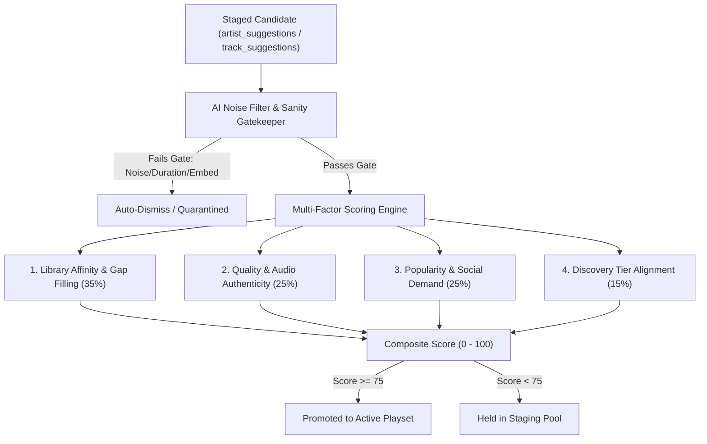

# 🗺️ MusicMood Strategic Roadmap

> **Current focus: security and stability only, then the Android migration.**
> No new features are scheduled until Phase 4 is done. Every earlier feature item is frozen in the
> [Frozen Feature Backlog](#-frozen-feature-backlog-not-scheduled) at the bottom of this file.

Order is strict: each phase depends on the one before it.

### 🏷️ Release plan to `1.0`

Every fix ships as a letter release within `0.8.7x`, following [RELEASE_MANAGEMENT.md](RELEASE_MANAGEMENT.md). The version ceiling lock stays in place: no `0.9.0` and no other minor or major bump until all major issues below are fixed. `1.0.0` is reserved for the launch once Phases 0–3 are complete.

| Release | Scope |
|---|---|
| `v0.8.7a` | Phase 0: emergency hardening |
| `v0.8.7b`… | Phase 1: Supabase Auth, with one letter per shippable step (sign-in, guests, roles, user migration) |
| next letters | Phase 2: RLS and RPC rewrite, then Phase 3 stability fixes, each in small letter releases |
| `v1.0.0` | All major issues fixed; launch baseline for the Android migration |

---

## 🚨 Phase 0 — Emergency Hardening (no client changes required)

Live-database findings (Nov 20 audit): RLS is enabled on all 17 tables, but grants and policies cancel it out.

* [x] **Revoke `TRUNCATE`, `TRIGGER`, `REFERENCES` from `anon` and `authenticated` on all `public` tables.** *(Done Nov 20, including default privileges for new tables; see `supabase/migrations/`.)* RLS does not apply to `TRUNCATE`, so today anyone holding the public key can empty `tracks` (107k rows) in one call. The app never uses these privileges.
* [x] **Revoke `EXECUTE` on `resolve_or_create_test_user` from `anon` and `authenticated`.** Anyone can currently mint an admin profile with it. *(Done Nov 20.)*
* [x] **Revoke public `EXECUTE` on maintenance functions** used only by scripts or triggers: `sync_track_artist`, `update_artist_track_count`, `sync_artist_affinity_from_*`, `get_*priority_inflation_candidates`, `get_random_unmapped_local_tracks`. *(Partly done Nov 20: trigger functions and `get_priority_inflation_candidates` revoked. `get_dynamic_priority_inflation_candidates` and `get_random_unmapped_local_tracks` stay callable until the scripts move to the service-role key in Phase 2.)* *(Completed in v0.8.7d: script-only RPCs restricted to the service role.)*
* [x] **Set `search_path`** on the 8 functions flagged by the Supabase security advisor. *(Done Nov 20.)*
* [ ] **Take a database backup** (manual: Supabase dashboard → Database → Backups) before any further policy work.
* [x] **Remove leaked data from `public/`:** `exploded_albums_manifest.json` (contains `\\192.168.0.2\e$\…` NAS paths) and the other `local_*` / `rejected_tracks.json` dumps. *(Done Nov 20; scanner output now goes to the gitignored `scripts/cache/`. The files remain in git history.)*
* [ ] **Rotate the Last.fm API key** and remove the hard-coded fallbacks in `src/` and `.github/workflows/`. *(Hard-coded key removed Nov 20; set `LASTFM_API_KEY` (scripts/workflows) and `VITE_LASTFM_API_KEY` (client). Rotating the old key on last.fm is still a manual step.)*
* [x] **Remove the shared guest password** (`guestpassword123`) from `src/services/supabaseService.js` and `scripts/createGuest.js`, and disable that account. *(Done Nov 20: password fallback and `scripts/createGuest.js` removed; the account is banned (it had never signed in).)*
* [x] **Remove hard-coded admin email checks** (`isTargetAdmin`) and personal email from the client bundle. *(Done Nov 20: roles come only from the database. The author email in the About modal is kept as intentional attribution.)*
* [x] **Workflows:** fail fast when `SUPABASE_SERVICE_ROLE_KEY` is missing instead of silently falling back to the publishable key. Pass `github.event.inputs.*` through `env:` instead of interpolating them into `run:` scripts (shell injection). *(Shell-injection fix done Nov 20. Service-role fail-fast moves to Phase 2, because the workflows currently write with the publishable key.)* *(Fail-fast completed in v0.8.7c.)*
* [x] **Drop or lock unused tables** `history` and `music_users`, after confirming nothing reads them. *(Locked Nov 20: API access revoked.)*
* [x] **Patch dependencies:** `npm audit fix` (high: `music-metadata`, moderate: `file-type`). *(Done Nov 20: `npm audit` reports 0 vulnerabilities.)*

---

## 🔐 Phase 1 — Supabase Auth (replace the custom identity system)

Goal: `auth.uid()` is the only source of user identity. Today only 1 of 11 profiles is linked to a real `auth.users` row; identity is asserted by the client.

* [ ] **Custom domain (do this first):** buy a proper domain to replace `musicmood-ghx2.onrender.com` and point it at Render, which supports custom domains with free TLS. Do it before the Supabase Auth setup, because the domain feeds into the Google OAuth authorized origins and redirect URIs, the Supabase Site URL and redirect allow-list, and later the privacy policy URL and Android app links. Update the hard-coded Render URL in `scripts/scrapeLastFmArtists.js` and set the Render URL to redirect to the new domain.
* [x] **Google provider in Supabase:** enable it under Auth → Providers, add the Google OAuth client ID/secret, and register the Supabase callback URL in Google Cloud Console. *(Pending: dashboard setup by owner. Also enable Anonymous sign-ins and manual identity linking, and set the Site URL and redirect URLs.)* *(Done Nov 21.)*
* [x] **Web sign-in:** `supabase.auth.signInWithOAuth({ provider: 'google', scopes: 'youtube.readonly' })`, using `session.provider_token` for playlist import. (Android will later use Credential Manager + `signInWithIdToken` against the same backend.) *(Code ready on `claude/phase1-supabase-auth` (Nov 21); `src/services/auth.js`. The provider token is kept in sessionStorage with a 55-minute expiry.)* *(Shipped in v0.8.7b; YouTube scope split out in v0.8.8.)*
* [x] **Guests:** `signInAnonymously()` per guest, and `linkIdentity()` to upgrade a guest to Google while keeping their data. Remove the shared guest ID `f7337681-…`. *(Code ready (Nov 21). The shared guest id is removed from the client.)* *(Shipped in v0.8.7b.)*
* [x] **Client identity:** replace `getResolvedUserId()` and the localStorage profile with the Supabase session. Remove `isAdmin()`/role checks that read localStorage. *(Code ready (Nov 21). The session user id is held in memory; the localStorage profile is a display cache only.)* *(Shipped in v0.8.7b.)*
* [x] **Profile creation** via the `handle_new_user` trigger on `auth.users`. *(Done Nov 21: `on_auth_user_created_profile` and `on_auth_identity_created_profile` triggers, plus `get_my_profile()` self-heal.)*
* [x] **Roles:** move `role` / `user_class` into a `user_roles` table that only the service role can write; add an `is_admin()` SQL helper. Users must not be able to edit their own role. *(Done Nov 21 with a different design: the `trg_protect_profile_privileges` trigger blocks client writes to role, user_class, google_id and is_guest, and `is_admin()` was added. No separate table needed.)*
* [x] **Remove** `resolve_or_create_user` (both overloads) and `resolve_or_create_test_user`. Remove the test-persona switcher from the production build. *(Persona switcher removed from the client (Nov 21). The RPCs are dropped in the release after the new sign-in is live, so open old tabs keep working until then.)* *(RPCs dropped in v0.8.7d.)*
* [x] **Migrate the 2 real users** with a one-off SQL script: re-point `user_favorites`, `listening_history`, `user_dealbreakers`, `user_mood_genre_affinities`, `feedback` and calibration to the new `auth.users` IDs. Decide what happens to the 2,186 history rows under the old shared guest ID. *(Automated Nov 21: `claim_legacy_profile()` merges a legacy profile into the new account on the user's first Google sign-in, matched by the verified Google user id. Shared-guest history stays orphaned.)* *(Owner account migrated automatically on first sign-in (Nov 21).)*

---

## 🛡️ Phase 2 — Row Level Security & RPC Rewrite

**Target permissions** (guests and Google users are both `authenticated`; guests have `is_anonymous = true`):

| Action | Guest | Google user | Admin |
|---|:---:|:---:|:---:|
| Read catalog (tracks, artists, genres, moods, staged candidates) | ✅ | ✅ | ✅ |
| Own favorites, own listening history, own calibration | ✅ | ✅ | ✅ |
| Upvote a track (once per track, ±1) | ✅ | ✅ | ✅ |
| Suggest / request an artist (insert only, rate-limited) | ✅ | ✅ | ✅ |
| Flag a wrong genre (own flags only) | ✅ | ✅ | ✅ |
| Send feedback (insert only) | ✅ | ✅ | ✅ |
| Read other users' data | ❌ | ❌ | dashboard only |
| Insert / update / delete catalog rows (tracks, artists, local_metadata) | ❌ | ❌ | via service role / admin RPCs |
| Edit or delete suggestions, flags, feedback | ❌ | ❌ | ✅ |

**Live check, Nov 21** (simulated anonymous guest, rolled back): a guest can still insert, update and delete any `tracks` row, update any `artists` and `local_metadata` row, delete any `artist_suggestions` row, read another user's favorites via `get_user_favorites(other_id)`, and upvote with a delta of 1,000,000. Guests can't read others' listening history. Everything in the ❌ rows is closed in this phase.

* [ ] **Baseline migration:** dump the live schema (tables, policies, functions, triggers) into `supabase/migrations/` so the database can be rebuilt from the repo. Retire `schema_v2.sql` / `setup_taste_graph.sql` as sources of truth.
* [x] **Catalog tables** (`tracks`, `artists`, `local_metadata`, `artist_suggestions`, `track_suggestions`, `track_subgenres`, `genres`, `moods`): read-only for clients. Writes only via the service role (scripts/workflows) or narrow vetted RPCs. Drop every `USING (true)` insert/update/delete policy. *(Done in v0.8.7c.)*
* [x] **User tables:** `auth.uid() = user_id` for every operation. Drop `Allow anon insert/select on listening_history`. *(Done in v0.8.7c/d.)*
* [x] **RPCs:** remove all `p_user_id` parameters; use `auth.uid()` inside. Applies to `get_user_favorites`, `sync_user_favorites`, `remove_user_favorite`, `get_user_calibration`, `sync_user_calibration`. *(Done in v0.8.7d.)*
* [x] **`upvote_track`:** clamp the delta to ±1 and make it idempotent per user via `user_upvotes (user_id, track_id)` (old item #13). *(Done in v0.8.7d.)*
* [x] **`track_genre_flags`:** authenticated insert of own flags only; review and delete restricted to admins. *(Done in v0.8.7c.)*
* [x] **`feedback`:** insert-only for users; reading restricted to admins. *(Done early in Phase 0, Nov 20.)*
* [ ] **Revoke `anon` access** to everything not needed before sign-in (GraphQL exposure lints 0026/0027).
* [x] **Server endpoints** `/api/resolve-track` and `/api/playlist-tracks`: require a valid Supabase JWT and add rate limiting so the server can't be used as an open scraping proxy. Add security headers (CSP, HSTS) to `server.js`, and stop returning raw `err.message` to callers. *(Done in v0.8.7e; CSP is report-only until verified on the live site, then switch it to enforcing.)*
* [ ] **Client-side catalog search:** escape `%` and `_` in `ilike` filters (artist/title duplicate checks, search), or move those lookups into RPCs.
* [x] **Google access token:** stop persisting it in `localStorage` (`src/services/auth.js`); keep the Supabase session's `provider_token` in memory only. *(Done in v0.8.7b: tab-scoped sessionStorage with expiry, cleared on sign-out.)*
* [ ] **Public data exposure:** `local_metadata` (personal library, file paths) and `artist_suggestions` should not be readable without sign-in.
* [x] **Scripts and workflows on the service-role key:** once catalog writes are closed to clients, require `SUPABASE_SERVICE_ROLE_KEY` (fail fast if it's missing), then revoke public `EXECUTE` on `get_dynamic_priority_inflation_candidates` and `get_random_unmapped_local_tracks`. *(Done in v0.8.7c/d.)*
* [x] **Verification:** replace `scripts/verify_rls.js` with tests that *fail* if `anon` can read another user's data, write the catalog, or call privileged RPCs. Supabase security advisor must be clean. *(Done in v0.8.8: supabase/tests/permissions.sql (22 checks, all passing).)*

---

## 🧱 Phase 3 — Stability

* [x] **No client-side catalog deletes:** replace the global purges in `Player.jsx` (playback errors) and `sessionStateMachine.js` (dislike → delete JIT track) with an `unplayable_reports` flag reviewed by a job. One user's region lock must not delete a track for everyone. *(Done in v0.8.7c.)*
* [x] **Listening history actually records:** handle tracks without a `dbId` (`track_id` is `NOT NULL`), and align mood IDs; `sad` and `party` are missing from the `moods` table, so inserts fail silently today. *(Done in v0.8.7f: track_id was nullable after all; the real losses were 22 missing moods, multiple rows per play and no listening time.)*
* [x] **Design the 24 non-core moods:** only the 6 core moods (Focus, Chill, Energetic, Happy, Sad, Party) have home genres and calibration. The other 24 (Late Night, Roadtrip, Study, Rainy Day, cinematic moods, etc.) are registered since v0.8.7f so their plays are recorded, but need home genres, genre mappings and a decision on which stay visible. *(Done in v0.8.7h.)*
* [x] **Single mood/genre vocabulary:** reconcile `moods.js`, `MOOD_GENRE_MAP` in `tasteGraph.js` and the `moods`/`genres` tables. Remove dead genre IDs (`dream_pop`, `motown`, `90s_alt`, `space_rock`, `rnb_contemporary`, `fingerstyle`, `acoustic_guitar`). *(Done in v0.8.7h.)*
* [x] **Column naming:** `local_metadata.youtube_id` vs `youtube_video_id`; pick one and migrate. *(Done in v0.8.8: the live table only has youtube_video_id; stale SQL moved to supabase/legacy/.)*
* [x] **State machine correctness:** *(Done in v0.8.7g. The dwell cap was removed by design, since genre lock is intended. The hop-limit issue was in dead code; Surprise Me already enforces the tiers.)*
  * Explicit states and transitions; `getNextTrack` must distinguish "busy" from "nothing playable".
  * One shared artist-cooldown window across all sourcing paths (currently 15 / 10 / 5); the emergency path must run the full guards.
  * Bound `recentTracks` in memory, not only when saving.
  * Either enforce `MAX_DWELL_PER_NODE` or remove it (`getMaxDwell()` returns `Infinity`).
  * Discovery tiers must respect their hop limits (anchors currently bypass them).
* [x] **Scheduled job timeouts:** "Hourly Catalog Sanity, Maintenance & Discovery" (`reconcile-flags.yml`) keeps hitting its 20-minute job timeout. Its last step (artist avatars) is cancelled on every run since Nov 20, and the run is reported as *cancelled*. Split the job, or give the slow steps their own time budgets. *(Fixed Nov 21: duplicate merge step removed, avatars capped at 6 minutes / 120 per run and non-fatal, job limit 30 minutes.)*
* [x] **Single scraper implementation:** remove the duplicate of the `server.js` logic in `vite.config.js`. *(Done in v0.8.8: server/youtubeResolver.js.)*
* [ ] **Error handling:** surface failed writes instead of `console.warn` and continuing.
* [x] **Tests:** unit tests for the state machine and graph traversal; integration test for sign-in → favorites → history under RLS. *(Done in v0.8.8: 26 unit tests + 22-check permission test; CI for both.)*
* [x] **Repo hygiene:** fix `.gitignore` entries for tracked files (`src/App.jsx`, `src/main.jsx`, `src/index.css`); strip the admin/test UI from the production bundle. *(Done in v0.8.8: .gitignore was already fixed upstream; the admin JIT monitor is lazy-loaded.)*

---

## ✅ Before Android: open owner tasks

* [ ] **Publish the Google OAuth app** (Google Cloud → Google Auth Platform → Audience → *Publish app*). Since v0.8.8 sign-in uses only basic scopes, so no verification is needed for sign-in. YouTube playlist import stays behind Google's "unverified app" warning until the app is verified for `youtube.readonly`.
* [ ] **Branding:** set the OAuth app name to "MusicMood" (Google Auth Platform → Branding) so the consent screen stops showing the Supabase project domain. With the custom domain, also add it as an authorized domain.
* [ ] **Optional: add `SUPABASE_DB_URL`** as a repository secret to enable the weekly permission test.
* [ ] **Rotate the old Last.fm key; add `SUPABASE_SERVICE_ROLE_KEY` to local `.env`.**

## 📱 Phase 4 — Android Migration

Starts only after Phases 0–3 are complete.

* [x] ~~**Engine portability**~~ — not needed: the app uses Capacitor, which runs the same React code (including `localStorage`) inside Android's WebView.
* [~] **Android client (Capacitor 8):** shell in `android/`, versioned builds, background pause, visible TV player, phone layout fixes. *(Started in v0.8.8e.)*
* [ ] **Native Google sign-in** via Credential Manager + `supabase.auth.signInWithIdToken` (needs an Android OAuth client in Google Cloud: package name + signing-key SHA-1).
* [ ] **Phone polish:** compact Calibrate window and welcome screen on phones; prefer YouTube audio uploads so the TV mostly shows a still cover.
* [ ] **Minimum-version check** ("Please update") and a signed Android build workflow attached to the auto-release.
* [ ] **Play Store:** developer account ($25), closed test with 12 testers for 14 days, store listing (icon, banner, screenshots, texts, data safety, content rating), Render paid plan so the server does not sleep.

### 🌐 Custom domain switch (do before the first Play Store release)
1. Buy the domain on **Cloudflare Registrar** (DNS on Cloudflare keeps WAF, rate limiting and Turnstile available).
2. **Render:** add the domain (and `www`) under Custom Domains; add Render's DNS records in Cloudflare with the proxy (orange cloud) **off** until Render shows the certificate, then turn it on and set SSL to **Full (strict)**. Redirect `www` to the main address with a Cloudflare rule.
3. **Supabase** (Authentication → URL Configuration): new Site URL and redirect URLs; keep the `onrender.com` entries for a few weeks, then remove them.
4. **Google Cloud** (OAuth app): add the domain as an authorized domain; update homepage and privacy-policy links.
5. **Code:** `server.js` redirects `*.onrender.com` to the new domain and reads the visitor address from `CF-Connecting-IP`; `.env.android` points `VITE_API_BASE_URL` at the domain.
6. **App ID:** set the final Android app id (reverse domain, e.g. `app.musicmood`) before the first Play upload; it can never change afterwards.
7. **Cloudflare rules:** never put browser challenges (or Bot Fight Mode) in front of `/api/` — the Android app cannot solve them; use rate-limit and block rules instead.

> Google Play / YouTube policy compliance (playback model, store listing requirements) is intentionally out of scope for now and will be planned separately after the security work.

---

## ❄️ Frozen Feature Backlog (not scheduled)

Kept for reference only. Nothing below is worked on until Phase 4 ships.

### 🎯 Former High Priority (v0.6.1)

### 1. 🎛️ Custom Default Subgenres per Mood (Core 6 Moods)
* **Problem:** Clicking a mood (such as *Party* or *Happy*) currently routes to a hardcoded genre cluster (`MOOD_GENRE_MAP`), often defaulting to genres the user rarely listens to (e.g. `funk` or `classic_soul`). Listeners must manually select their preferred genre each time.
* **Scope:**
  * Allow listeners to define and persist their preferred starting subgenre for at least the **6 core moods**:
    1. 😊 **Happy** (e.g., *Indie Pop*, *Dance-Pop*, *Bluegrass*, *Bossa Nova*)
    2. 😢 **Sad** (e.g., *Singer-Songwriter*, *Post-Rock*, *Delta Blues*)
    3. 🧘 **Chill** (e.g., *Lofi Hip-Hop*, *Neo-Soul*, *Chillout House*)
    4. ⚡ **Energetic** (e.g., *Synthwave*, *Hard Rock*, *Drum & Bass*)
    5. 🧠 **Focus** (e.g., *Neo-Classical*, *Minimalist Ambient*, *Lofi Beats*)
    6. 🎉 **Party** (e.g., *House*, *Dance-Pop*, *Nu-Disco*, *Hard Rock*)
* **UX Implementation:**
  * **Quick-Pin in Player:** A subtle 📌 *"Set as default for [Mood]"* button right beside the Active Node dropdown in the playback bar.
  * **Calibration Panel:** A dedicated *"Mood Defaults"* section inside the Taste Calibration view where users can select their go-to genre for each mood from their personal anchors.
* **Engine & Storage:**
  * `sessionEngine.setMood(moodId)` checks `calibration.moodDefaults?.[moodId]` before falling back to generic graph defaults.
  * Persisted locally in `localStorage` and synced to `user_profiles.calibration` in Supabase for cross-device consistency.

---

### 🚀 Near-Term Enhancements

### 2. 🔍 "Add Your Own Artist" (On-Demand Metadata & 10-Track Harvest)
* Search any artist on demand via MusicBrainz API (`https://musicbrainz.org/ws/2/artist/`).
* Automatically normalize community tags into MusicMood's 115-node taxonomy.
* Harvest the top 10 iconic tracks via YouTube zero-quota resolver (`/api/resolve-track`) and ingest them into `public.tracks`.
* Instantly create an on-demand artist radio station or anchor seed.

### 3. 🤖 "Ask AI What You Want" (Conversational Sonic Intent Parser)
* Natural language prompt input (e.g., *"I'm working late at night in the rain, give me something instrumental with deep bass and melancholic piano but no harsh drops"*).
* Converts semantic intent into mathematical engine parameters: Target Energy ($E$), Target Valence ($V$), Vocal Policy (`instrumental_strict`), and taxonomy anchor nodes.
* Strict Anti-AI Audio Integrity: Operates strictly as an intelligent acoustic curator—every selected song is authentic human music from our verified catalog.
* **Low-Priority Extension — Granular Vocal Control & Voice Input:**
  * Hands-free voice prompting via Web Speech API / microphone dictation.
  * Explicit vocal texture steering: strict instrumental, vocal-prominent, vocal chops/chants, or vocal gender/timbre preferences.

### 4. 🌍 User-Selected Localized / Regional Music
* Optional language filter (e.g., French, Romanian, Japanese, Spanish, Italian) on demand.
* Kept strictly opt-in so regional music never plays unless explicitly activated.

### 5. ❤️ YouTube "MusicMood Favorites" Auto-Sync
* Optional two-way or append-only sync from in-app Favorites into a dedicated playlist titled `"MusicMood Favorites"` on the user's authentic YouTube account.

### 6. 🔊 In-App Master Volume Slider & Mute Control *(Completed in v0.8.3)*
* **Status:** ✅ **Shipped in v0.8.3**
* **Problem:** Currently playback volume is locked to 100% in the underlying YouTube player (`setVolume(100)`). Users without hardware media keys cannot easily balance MusicMood against other audio.
* **Scope:**
  * Add a sleek, glassmorphic volume slider + mute toggle directly into the player control bar.
  * Persist the listener's preferred volume level across sessions in `localStorage`.

### 7. 📑 Dynamic Playlist Creation & Smart Favorites Curation (Concept Backlog)
* **Idea & Purpose:** Provide the ability to create, assemble, and manage playlists without cluttering the airy player interface.
* **Smart Auto-Pick from Favorites:**
  * Automatically analyze and cluster the listener's favorited / liked tracks by headspace, energy profile, or genre adjacency.
  * 1-click generation of thematic playlists (e.g., *Late Night Introspection*, *High-Velocity Workout*, *Deep Focus Instrumental*).
* **Flow & Integration Exploration (To Determine Later):**
  * Devise a clean, decluttered flow (e.g., initiated from a dedicated Favorites view, post-session recap, or minimal popup rather than overcrowding the playback bar).
  * Flexible export: option to keep as a virtual MusicMood session or sync directly to YouTube.

### 7. 📊 Sonic Analytics & Community Insights Dashboard
* **Purpose:** Celebrate listening habits, surface top hits across the community, and spotlight listener dedication with personal and global analytics.
* **Core Analytics Features:**
  * 🎵 **Most Popular Songs:** Top-streamed, most-favorited, and highest-completion tracks across all listening sessions (filterable by All-Time, Month, Week).
  * 🎸 **Top Artists Leaderboard:** Artists ranked by overall engagement and real-time `affinity_score`, distinguishing mainstream anchors from rising underground discoveries.
  * 👑 **Most Active User Spotlight ("The Pioneer's Podium"):**
    * Highlights the platform's #1 most active listener (`Corneliu / @me :D`) with total listening hours logged, tracks completed, songs favorited, and genre exploration breadth.
    * Personal listener card comparing your personal top rotation vs. platform-wide trends.
  * 🗺️ **Mood & Genre Flow Heatmap:** Visual breakdown showing which of the 6 core moods and 115 taxonomy nodes dominate morning, afternoon, and late-night listening.
* **Engine & Database Architecture:**
  * Backed by efficient, cached Supabase PostgreSQL RPCs (`get_platform_analytics()`, `get_listener_stats(user_id)`) querying existing `listening_history`, `user_favorites`, and `artists.affinity_score` with zero client-side calculation overhead.

### 8. ⚡ Catalog Rebalancing & Underrepresented Genre Overhaul (Bottom-Up Inverted Seeding)
* **The Root Cause (The "Top of the List" Skew):**
  * An audit of our 50,000+ track catalog reveals a massive structural imbalance caused by legacy folder scans and top-to-bottom sequential processing:
    * **The "Big 4" (Over 36,600 tracks — 75% of catalog):**
      * 🎸 **Rock:** 15,368 tracks
      * 🎻 **Classical:** 8,001 tracks
      * 🎷 **Jazz:** 7,276 tracks
      * ⚡ **Metal:** 5,960 tracks
    * **The Underrepresented 8 (Severely starved down the list):**
      * 🎛️ **Electronic:** 3,666 tracks *(1,200+ diluted in generic catch-all bucket)*
      * 🎤 **Pop:** 2,247 tracks *(970+ diluted, with rock legends like Dire Straits & Rolling Stones misclassified as Pop)*
      * 🎧 **Hip-Hop:** 1,668 tracks *(golden age boom-bap, west coast, conscious rap all < 185 tracks)*
      * 🪕 **Folk & Acoustic:** 1,426 tracks
      * 🎸 **Blues:** 1,214 tracks
      * 🎷 **Soul & Funk:** 1,039 tracks
      * 🪘 **Latin & World:** 736 tracks
      * 🌴 **Reggae:** 321 tracks
* **Architecture & Action Plan for Tomorrow:**
  * **1. Inverted Seeding Strategy (Bottom-Up Priority):**
    * Invert the candidate ingest loop (`ORDER BY genre_track_count ASC`) so background seeders and balancing runs strictly populate the bottom 8 genres first (starting with Reggae, Latin, Soul/Funk, Hip-Hop, Pop, Electronic) before touching Rock, Metal, or Classical.
  * **2. Tag Evacuation & Disambiguation Migration:**
    * *Pop Evacuation:* Move misclassified classic rock acts (*Dire Straits, Rolling Stones, Fleetwood Mac, Sting*) out of `pop` into `classic_rock` / `hard_rock`.
    * *Pop Subgenre Re-sorting:* Re-route authentic pop into `dance_pop` (Dua Lipa, Madonna), `synth_pop` (Depeche Mode, CHVRCHES), `art_pop` (Kate Bush, Björk, Lorde), and `mainstream_pop` (Michael Jackson, The Weeknd, Bruno Mars).
    * *Hip-Hop Decomposition:* Separate golden-age `boom_bap` (Wu-Tang, Nas, Biggie, Tribe), `west_coast_rap` (2Pac, Dr. Dre, Snoop), `conscious_hiphop` (Kendrick Lamar, J. Cole, Mos Def), and modern `trap_modern` (Travis Scott, Future).
  * **3. Targeted Artist Inflation for the Bottom 8 Families:**
    * Run `npm run inflate:artists` across the 10 foundational icons for each underrepresented family:
      * *Electronic:* Aphex Twin, Boards of Canada, Daft Punk, Kraftwerk, Massive Attack, Prodigy, Pendulum, Carpenter Brut.
      * *Hip-Hop:* Nas, Wu-Tang Clan, 2Pac, The Notorious B.I.G., Kendrick Lamar, A Tribe Called Quest, Outkast, Dr. Dre.
      * *Pop:* Michael Jackson, Prince, Madonna, Dua Lipa, The Weeknd, Kate Bush, Phoenix, Depeche Mode.
      * *Reggae & Latin:* Bob Marley, Peter Tosh, Burning Spear, Buena Vista Social Club, Celia Cruz, Antonio Carlos Jobim.
      * *Soul & Funk:* Stevie Wonder, Earth Wind & Fire, Marvin Gaye, Parliament, Curtis Mayfield, Aretha Franklin.
  * **4. Energy & Instrumental Filtering:**
    * Ensure electronic/ambient tracks have verified instrumental flags and hip-hop/pop have proper energy baselines so the 6 Core Moods (Focus, Chill, Party, Workout) never pull the wrong sonic texture.

### 9. 🏷️ In-Player "Wrong Genre / Misclassified" Flag & Re-Assignment Button
* **The Problem:**
  * When a track plays in the wrong genre (e.g., Dire Straits in Pop, or an ambient drone in Techno), listeners currently only have the Dislike (👎) button.
  * Disliking penalizes the artist's affinity score and risks purging a masterpiece song, when the song is actually great and simply has an incorrect genre tag.
* **UX & Interaction Design:**
  * Add a clean **"Wrong Genre" (🏷️)** action button in the player control bar next to Upvote/Favorite/Dislike.
  * **1-Click Healing Flow:**
    * Clicking immediately skips the track from the active session queue *without* downvoting the artist's affinity or purging the stream.
    * Displays a minimal glassmorphic popover: *"Where does this belong?"* featuring 1-click pills for the 14 parent genre families (e.g., `[Rock]`, `[Metal]`, `[Electronic]`, `[Jazz]`, `[Classical]`, `[Hip-Hop]`).
    * Clicking a family immediately updates `public.tracks.primary_genre_id` in Supabase, healing the catalog in real-time for all listeners.
* **Automated Self-Healing Backend:**
  * Tracks flagged with misclassification reports can also trigger a background lookup through our MusicBrainz / iTunes genre normalizer to re-verify the community consensus tags.

### 10. 🎛️ Taxonomy Rebalancing: Re-group `synth_pop` into `Electronic` & Reconcile Artist Plurality
* **The Problem:**
  * In `src/services/tasteGraph.js`, `synth_pop` was historically categorized under `group: 'Pop'` alongside `dance_pop` and `mainstream_pop`.
  * Consequently, foundational electronic and darkwave pioneers like **Depeche Mode**, **New Order**, **Orchestral Manoeuvres in the Dark (OMD)**, and **Pet Shop Boys** are automatically mapped to the **✨ Pop** parent genre family in the Artist Explorer.
  * In the tracks database, Depeche Mode's true catalog plurality is **`electronic`** (106 tracks vs. 97 tracks in `synth_pop`, and 0 tracks in `pop`).
* **Scope & Implementation:**
  1. **Taxonomy Realignment in `src/services/tasteGraph.js`:**
     * Change `GENRE_NODES['synth_pop'].group` from `'Pop'` to `'Electronic'`.
     * Correctly groups authentic synth pioneers with `synthwave`, `darksynth`, `industrial`, and `idm`.
  2. **Artist Plurality Reconciliation:**
     * Update `public.artists.primary_genre_id` to reflect actual track plurality (e.g. Depeche Mode -> `electronic`).
     * Ensure the sync script and nightly cron resolve plurality accurately when artists straddle related electronic subgenres.

### 11. ⚖️ Track Upvote vs. Artist Affinity Rebalancing & Anti-Runaway Gating
* **The Question & Dilemma:**
  * When a listener upvotes a specific track, should the artist also receive an upvote/affinity boost?
  * While intuitive, unmitigated 1:1 artist upvoting threatens recommendation balance in two key ways:
    1. **The "One-Hit Wonder" / Eclectic Single Trap:** A listener may love an isolated crossover single or acoustic ballad (e.g., Gotye's *Somebody That I Used to Know* or an acoustic track by an otherwise aggressive metal band). Blindly boosting the artist floods future sessions with their broader catalog that the user may actively dislike.
    2. **The "Rich-Get-Richer" Catalog Bias:** Prolific legacy artists with 100+ catalog tracks (e.g., Queen, Depeche Mode, Pink Floyd) accumulate artist affinity exponentially faster than indie or long-tail artists with 5 tracks, crowding out discovery.
* **Proposed Architecture & Evaluation for Implementation:**
  * **Option A — Fractional / Attenuated Boost:** A track upvote counts as `1.0` for the track, but applies a bounded, attenuated nudge (`0.2` to `0.25`) to the artist's score.
  * **Option B — Multi-Track Confirmation Threshold:** Upvoting 1 song counts strictly for the track; upvoting 2 or more distinct tracks by the same artist confirms genuine fandom and unlocks the artist affinity boost.
  * **Option C — Contextual / Mood-Scoped Affinity:** The artist's affinity boost is scoped to the active mood (e.g., *Focus* or *Chill*) rather than inflating the artist globally across all moods.
  * **Non-Negotiable Recommendation Guardrails:**
    * Regardless of affinity score, the state machine must strictly enforce artist dwell cooldowns (no more than 1 track per 6–8 songs from the same artist in a session).
    * Maintain a 40–50% discovery floor in candidate selection so top-affinity repeat anchors never monopolize the queue.

### 12. 📱 Mobile Background Playback & Web Media Session API (Lock Screen & Notification Controls) *(Completed in v0.8.3)*
* **Status:** ✅ **Shipped in v0.8.3**
* **Feedback Origin:** *User Feedback (Nov 10)*: *"No back next buttons on mobile in background mode, i wanna skip songs without opening up the browser, just from notification box"* & *"Background playback not working"* & *"Misfits the screen on phone"*.
* **Scope & Implementation:**
  * **Web Media Session API (`navigator.mediaSession`):**
    * Wire media session metadata: track `title`, `artist`, `album` (genre/mood), and high-res artwork thumbnails (`hqdefault.jpg`).
    * Implement action handlers for `play`, `pause`, `previoustrack`, and `nexttrack` directly hooked to `Player.jsx` and `sessionEngine.skipCurrentTrack()`.
    * Allows listeners to skip, pause, and view current song info directly from the Android / iOS notification shade and lock-screen widget.
  * **Mobile Screen Fit & Viewport CSS Hardening:**
    * Transition mobile layout containers to dynamic viewport units (`100dvh`) to prevent address-bar clipping.
    * Rebalance player action buttons on mobile screens (< 480px) to prevent button wrap or off-screen overflow.
  * **Background Audio Persistence:**
    * Evaluate audio keep-alive and iframe visibility handling to minimize mobile browser suspension when screens lock.

### 13. 🛡️ Authenticated User Upvote Isolation & Anti-Bot Protection (`public.user_upvotes`)
* **Feedback Origin:** *User Feedback (Nov 10)*: *"remember upvotes as well...otherwise bots might be able to destroy your library"*.
* **Scope & Implementation:**
  * **Database Architecture:**
    * Create a dedicated `public.user_upvotes` table in PostgreSQL with primary key `(user_id, track_id)` and foreign keys to `auth.users` and `public.tracks`.
    * Enable Row Level Security (RLS) so users can only manage their own upvotes (`user_id = auth.uid()`).
  * **Anti-Bot & Rate-Limiting Guard:**
    * Remove unauthenticated client ability to mutate global `tracks.upvotes` or `artists.affinity_score` arbitrarily.
    * Upvotes become idempotent per user, preventing automated scripts or repeated API calls from spamming votes.
    * Calculate public popularity via aggregated counts (`COUNT(user_upvotes)`) or throttled security-definer triggers.

### 14. 🔗 Player In-App Artist Navigation (Decouple Internal Navigation from YouTube Outlink) *(Completed in v0.8.4)*
* **Status:** ✅ **Shipped in v0.8.4**
* **Feedback Origin:** *User Feedback (Nov 10)*: *"change the track link in the player to bring you to the artist, and only the YT button brings you to youtube"*.
* **Scope & Implementation:**
  * In `src/components/Player.jsx`, decouple the track info click handler:
    * Clicking the **Artist Name** or **Artist Avatar** will open the new Top-Level Artist Explorer (`ArtistsExplorer.jsx`) filtered directly to that artist's discography.
    * The external YouTube icon/pill remains the sole link that opens the video on `youtube.com`.
  * Keeps the listener inside MusicMood's focused audio environment without accidental redirects.

### 15. ☁️ Cross-Device Database Sync for Genre & Mood Preferences
* **Feedback Origin:** *User Feedback (Nov 10)*: *"save genre preferences into db so it's consistent across session and devices"*.
* **Scope & Implementation:**
  * Store active genre selections, pinned mood defaults (Item #1), and acoustic steering toggles (vocal preferences, energy level) in `public.user_profiles.calibration` or a dedicated preferences JSONB column in Supabase.
  * On login across any desktop, tablet, or phone, load the listener's preferences seamlessly so sessions never revert to blank defaults.

### 16. 📻 Last.fm & External Profile Library Scraper / Importer
* **Feedback Origin:** *User Feedback (Nov 12)*: *"Scrape https://www.last.fm/user/octakhan888/library/artists profile for bands"*.
* **Scope & Implementation:**
  * Add an import utility allowing users to supply their Last.fm username or library URL (`https://www.last.fm/user/<username>/library/artists`).
  * Fetch top artists and listening frequencies via the Last.fm API (`user.getTopArtists`) or web profile parser.
  * Cross-reference imported artists against MusicMood's 115-genre taxonomy.
  * Automatically harvest or anchor the user's favorite artists in the database, generating a customized personal radio profile.

### 17. 🪟 Auto-Dismiss Modals & Panels on Playback Trigger
* **Feedback Origin:** *User Feedback (Nov 09)*: *"bug, when playing from favorites the window doesn't disappear in it's own"*.
* **Scope & Implementation:**
  * In `FavoritesModal.jsx` and `ArtistsExplorer.jsx`, automatically dismiss or collapse the modal/drawer when a listener clicks "▶ Play" on a song, immediately revealing the main player and visualization.

### 18. 🧭 Universal Sonic Profiler: Redesign Step 2 Onboarding as Natural Harmonic Bridge
* **Feedback Origin:** *User Feedback (Nov 13)*: *"emotional reflexes screen doesn't make much sense : (onboarding screen 2) - it needs to be a natural progression of step 1 (the star checker) and lead you into step 3 genre home for each state"*.
* **The Disconnect:**
  * **Step 1 (The Sonic Star)** sculpts the listener's broad acoustic identity across 6 poles (Rock, Electronic, Hip-Hop, Jazz, Folk, Classical) yielding an active flavor archetype.
  * **Step 2 (Current State)** abruptly drops into fragmented, isolated settings: a binary question for Sadness, a binary question for Focus, followed by negative Dealbreakers and an Anti-AI toggle. It fails to convey *why* these matter or how they connect to the polygon.
  * **Step 3 (6 Core Mood Homes)** suddenly presents 6 distinct headspaces (Focus, Chill, Energetic, Happy, Sad, Party) with generic home suggestions rather than smart, tailored predictions derived from the journey.
* **Proposed Architecture & UX Bridge:**
  * **1. Part A — Acoustic Texture Dynamic (Echoes Step 1):**
    * *Texture Bias:* How does your radar manifest in production? (e.g., Organic / Acoustic vs. Synthetic / Electronic).
    * *Lyrical Density:* Instrumental Focus vs. Lyrical / Vocal Storytelling across all sessions.
  * **2. Part B — Mood & Energy Responses (Directly Pre-Populates Step 3):**
    * *High Kinetic Drive (Prepares Energetic & Party):* Groove / Dance (House, Funk, Pop) vs. Raw Intensity (Heavy Metal, Hard Rock, DnB).
    * *Low Restorative State (Prepares Chill, Focus & Sad):* Atmospheric Catharsis (Deep, Minor-Key, Ambient/Post-Rock) vs. Gentle Uplift (Warm, Organic, Folk/Neo-Soul).
  * **3. Part C — Guardrails Footer (Clean & Docked):**
    * Move the Dealbreaker Shield and Anti-AI Music Gatekeeper into a sleek, secondary "Sonic Guardrails" collapsible bar or compact footer tray so negative filters do not dominate the emotional onboarding narrative.
  * **4. Algorithmic Prediction Engine for Step 3:**
    * Combine Step 1's Radar Pole weights with Step 2's Energy & Catharsis reflexes to compute exact, personalized home recommendations for all 6 moods in Step 3 (e.g., A Rock fan who chooses "Atmospheric Catharsis" gets `post_rock` or `doom_metal` predicted for Sad; an Electronic fan who chooses "Groove" gets `house` or `synthwave` for Party).

### 19. ⚖️ Automated Staged Ingestion Algorithm: Tiered Hybrid Pipeline (Option C)
* **Context & Problem Statement:**
  * MusicMood currently maintains thousands of high-potential candidate artists and tracks in staging (`public.artist_suggestions`, `public.local_metadata`, and live discovery feeds). While listeners can manually audition and request candidates (`+ Request`), expanding the playable library (`public.tracks` / `public.artists`) requires an autonomous, mathematically balanced ingestion algorithm.
  * A naive automated pull creates major risks:
    1. **The Pop Star Bias:** Mainstream acts with millions of plays crowd out indie, underground, and boutique masters.
    2. **Noise & Contamination:** Podcasts, live interviews, fan reactions, and karaoke stems degrade audio quality.
    3. **Taxonomy & Headspace Drift:** Random additions flood the active session with songs disconnected from the listener's calibrated mood anchors.
* **The 4-Pillar Composite Scoring Formula (0 to 100 Points):**
  * Each candidate in staging is evaluated using a normalized, multi-factor composite index:
    $$\text{Ingestion Score} = w_1 \cdot S_{\text{match}} + w_2 \cdot S_{\text{quality}} + w_3 \cdot S_{\text{popularity}} + w_4 \cdot S_{\text{gatekeeper}}$$



* **Detailed Pillar Breakdown:**
  1. **Library Coherence & Deficit Gap Filling (35% Weight — $S_{\text{match}}$):**
     * *Graph Proximity:* Shortest path distance in `tasteGraph.js` from active mood anchors and user calibration:
       * Direct subgenre match: $+25\text{ pts}$
       * 1 hop away (neighboring harmonic sound): $+15\text{ pts}$
       * 2+ hops away: $+5\text{ pts}$
     * *Library Deficit Compensation (Inverse Density):*
       * Underrepresented genres ($< 50$ tracks in active catalog) receive an automatic $+10\text{ pt}$ boost to build acoustic breadth.
       * Saturated genres ($> 1,500$ tracks) raise the threshold to prioritize only exceptional additions.
  2. **Quality & Audio Authenticity (25% Weight — $S_{\text{quality}}$):**
     * *Verified Metadata:* Clean MusicBrainz ID (`mbid`), authentic release year, and specific canonical subgenre taxonomy rather than generic catch-all buckets ($+15\text{ pts}$).
     * *Audio Stream Verification:*
       * Official YouTube Music Topic Channel match (`- Topic`): $+15\text{ pts}$
       * Verified studio track length between $2:00$ and $8:00$ (with extensions for Neo-Classical and Ambient): $+10\text{ pts}$
  3. **Popularity & Social Demand (25% Weight — $S_{\text{popularity}}$ — Damped / Egalitarian):**
     * *Direct User Requests:*
       $$\text{Request Score} = \min(20, \text{request\_count} \times 10)$$
       *(Any artist explicitly requested by listeners receives an immediate high-priority bump without breaking the 100-point ceiling).*
     * *Logarithmic Global Popularity:*
       Uses $\log_{10}(\text{Last.fm listeners})$ or playcount dampening so mega-pop stars never drown out high-quality niche or underground artists.
  4. **AI Gatekeeper & Noise Quarantine (15% Weight + Hard Veto — $S_{\text{gatekeeper}}$):**
     * *Hard Disqualification (Immediate Discard / Quarantine):*
       * Title contains blacklisted noise tokens: `podcast`, `interview`, `reaction`, `remastered stems`, `karaoke`, `ringtone`, `teaser`, `speech`.
       * Track duration $< 45\text{ seconds}$ or $> 25\text{ minutes}$ (unless Neo-Classical/Ambient).
       * Video flagged with YouTube embed restriction codes (`101` / `150`).
     * *Cleanliness Bonus:* Passes all sanitization checks with clean casing and zero mojibake/corrupt characters ($+15\text{ pts}$).

* **Architectural Options Comparison & Selection:**

| Dimension | Option A: Real-Time JIT Expansion | Option B: Scheduled Batch Curator | **Option C: Tiered Hybrid Pipeline (Selected)** |
|---|---|---|---|
| **Trigger** | While listening (dynamic queue replenishment) | Background Cron (GitHub Actions / Supabase Cron) | **Dual:** Background ranks staging pool; JIT pulls highest-ranked |
| **Ingestion Pace** | 1–2 tracks per session on demand | 10–25 tracks per run | **Continuous, smooth catalog growth** |
| **API Load** | Distributed across listening sessions | Concentrated periodic spikes | **Steady, quota-safe, and rate-limited** |
| **Responsiveness**| Immediate reaction to current mood | Pre-computed catalog additions | **Instant for active genre; structured for the rest** |
| **Pros** | Catalog expands where listener is listening | Predictable, auditable, batch-healable | **Combines instant session relevance with disciplined quality control** |
| **Cons** | Adds ~300ms network resolution to buffering | Unaware of listener's immediate headspace | Requires a lightweight priority view / queue in PostgreSQL |

* **Option C Implementation Blueprint:**
  1. **PostgreSQL Scoring View (`public.v_staged_ingestion_priority`):**
     * Pre-computes the composite priority score across `public.artist_suggestions` and `public.track_suggestions` using the 4 weighted pillars.
     * Materialized or indexed by `(primary_genre_id, ingestion_score DESC)`.
  2. **Dual-Speed Ingestion Engine:**
     * **Background Curator:** Hourly maintenance cron scans top candidates with $\text{Score} \ge 75$ in underrepresented genres and inflates their top 5–10 iconic tracks via zero-quota InnerTube resolution.
     * **Real-Time JIT Buffer Replenishment:** When an active session queue falls below low-watermark threshold for a specific genre, the JIT engine queries:
       ```sql
       SELECT * FROM public.v_staged_ingestion_priority 
       WHERE primary_genre_id = :activeGenre 
       ORDER BY ingestion_score DESC 
       LIMIT 5;
       ```
       Top-scoring candidates are inflated into `public.tracks` and woven into upcoming discovery slots.
  3. **Strict Non-Negotiable Guardrails:**
     * *Artist Dwell Cooldown:* Maximum 1 track from any newly promoted staged artist per 6–8 songs in a session.
     * *Discovery Floor:* Maintain 40–50% discovery ratio so promoted candidates complement established catalog anchors without overwhelming familiar hits.
     * *Status:* **Documented in Strategic Roadmap; implementation targeted post-v0.8.x stabilization.**

### 20. 🗂️ Player Header Real Estate & "Up Next" Button Compactification
* **Feedback Origin:** *User Feedback (Nov 16, 2026)*: *"up next button is not very useful and might be worth removing or making smaller to make more room for the name"*.
* **Problem:** On smaller screens, tablets, or compact desktop windows, the "Up Next: [Song Title]" button occupies significant horizontal width in the player bar, truncating long artist names or track titles.
* **Scope & UX Implementation:**
  * Transform the "Up Next" preview button into a sleek, compact icon button (e.g. `⏭️ Next`) with a glassmorphic hover card showing the upcoming title and thumbnail on mouseover.
  * Reclaim 120–160px of horizontal flex space dedicated to track and artist title display.
  * Add automatic responsive collapse on screens < 900px.

### 21. 🧬 Catch-All Taxonomy Decomposition ("General Rock" / "General Metal" to Leaf Subgenres)
* **Feedback Origin:** *User Feedback (Nov 16 & Nov 20, 2026)*: *"what is the music that falls in to 'General rock' are other general categories ? - lots of misclassified ones there"* & *"how do generic genres work, like rock, jazz metal general, are those the vaguely catalogued tracks or do they encompass or subgenres technically under that genre ?"*.
* **Problem:**
  * When third-party sources (MusicBrainz, Last.fm, iTunes) provide coarse tags, tracks default to top-level umbrella buckets (`rock`, `metal`, `jazz`, `electronic`).
  * While useful as parent genre containers in browse mode, generic umbrella tags obscure acoustic specificity and can cluster misclassified edge tracks.
* **Scope & Implementation:**
  * **Automated Subgenre Decomposition Cron:** Implement an offline classification pass that inspects tracks labeled simply `rock` or `metal`, queries MusicBrainz release and artist release group tags, and promotes them to specific leaf subgenres (e.g. `prog_rock`, `grunge`, `classic_rock`, `hard_rock`, `blues_rock`, `thrash_metal`, `death_metal`).
  * **Interactive Misclassification Sweep:** Run the consensus healing engine on tracks tagged with generic parent labels that have low confidence scores.

### 22. 📖 Taxonomy Hierarchy & Subgenre Inheritance Guide in UI
* **Feedback Origin:** *User Feedback (Nov 20, 2026)*: *"how do generic genres work, like rock, jazz metal general, are those the vaguely catalogued tracks or do they encompass or subgenres technically under that genre ?"*.
* **Scope & Implementation:**
  * Add an informative badge / tooltip in Artists Explorer and Taste Calibration explaining that:
    1. Parent Genre Families (e.g. Rock, Metal, Classical) act as overarching sonic umbrellas encompassing all 115 specialized subgenres.
    2. Browsing "Rock" seamlessly aggregates tracks from Prog Rock, Alt Rock, Post-Rock, Grunge, Classic Rock, etc., while legacy tracks with coarse tags reside in the baseline parent category until promoted by the healing pipeline.

---

---

## 📈 Completed Milestones

* [x] **v0.1.0:** YouTube OAuth 2.0 Auth & Foundation Discovery.
* [x] **v0.2.0:** Local Audio Scanner & 44.8k Song PostgreSQL Sync.
* [x] **v0.3.0:** Schema v2 Architecture (`public.tracks`, `public.artists`, `public.local_metadata`).
* [x] **v0.4.0:** Anti-Drift Session State Machine (2-track dwell cap, 15-artist cooldown, dynamic fatigue).
* [x] **v0.4.5:** 115-Node Canonical Music Taxonomy across 14 Genre Families.
* [x] **v0.4.8:** MusicBrainz Community Multi-Genre Integration (`secondary_genre_ids: text[]`).
* [x] **v0.5.0:** Zero-Quota YouTube Playlist Ingestion & 1-Click Sonic Calibration Wizard.
* [x] **v0.5.5:** Deduplicated SMB Scanner, NAS Ingestion & CP1252 Cyrillic Healing.
* [x] **v0.6.0:** Production Cloud Architecture on Render, Supabase Cloud Sync, Google Identity Services (GIS) Popup Auth, Role/Class RBAC, Single-Select Exclusive Paneling, and Responsive 2-Tier Header.
* [x] **v0.6.1:** User Mood Steering Lock (genre changes restricted strictly to user mood switches or Surprise Me button).
* [x] **v0.6.2:** Cloud Radar Persistence & Predictive Engine sync to Supabase.
* [x] **v0.7.0 / v0.7.0a:** 6 Core Mood Homes & Orbital Deviation Engine with unconstrained full-spectrum genre picker and clean tooltips.
* [x] **v0.7.4:** In-App User Feedback System, Muzike Network Share Ingestion (16,276 tracks), Full RLS Security Advisor Hardening on `user_favorites` and `local_metadata`, and Artist Discography Inflation Engine with Dynamic Affinity Triggers.
* [x] **v0.7.5:** In-Player "Wrong Genre" Misclassification Flagging (`public.track_genre_flags`), Offline Secondary Source Cross-Check & Consensus Healing Engine (`scripts/resolveFlaggedTracks.js`).
* [x] **v0.7.6:** Real-Time Energy Slider Steering Engine, Active Vocal Preferences (`Instrumental Only` / `Vocals` / `Any`), and In-Player Misclassification 1-Click Reporting.
* [x] **v0.7.7:** Top-Level Catalog Artist Explorer (10,849 artists across 14 parent genres, compact 2-row layout), Defense-in-Depth YouTube Playback Hardening, Watchdog Deadlock Elimination, Nightly Autonomous Reconciliation Cron, and In-App Author Attribution About Modal.
* [x] **v0.7.8:** Last.fm REST API Ingestion (+100 artists, 1,000 tracks), Anti-Duplication Chunk Sorting, In-App 1-Click Sync & "✨ Latest Added" Category.
* [x] **v0.7.9:** Dynamic Active Genre Locking, Dynamic Pagination (>11,200 artists, 61k tracks), Pre-Sale Code & Commercial Architecture Audit.
* [x] **v0.8.0 / v0.8.0a:** Artist Staging Area (`artist_suggestions`), Multi-Genre Balancer, Hourly Scanners, On-Demand Subgenre Locking, 2-Tier Open-License Artist Avatars, and 100% Staged Genre Normalization.
* [x] **v0.8.1a:** Canonical Artist Deduplication & Fuzzy Clustering (198 clusters unified), "Try Before You Request" Candidate Demo Player, and Diacritic/CJK Healing.
* [x] **v0.8.2:** Strict Genre Family Containment (`sameFamilyGenres`), Playback Fluctuation Elimination, Non-Disruptive Genre Review Flagging, Lossless CUE/APE Album Explosion & Online Ingestion Pipeline.
* [x] **v0.8.3:** In-App Master Volume Slider & Mute Toggle, Web Media Session API (Lock Screen & Notification Controls), Full Title Tooltips, and Toxic Secondary Tag Sanitization.
* [x] **v0.8.4:** Adaptive Buffering Engine (YouTube state 3 handling & 10s auto-nudge), Zero-Video Pure Audio Engine Lock (1x1px off-screen), Clean Single-Line Player Geometry & In-App Discography Navigation, Staged Artist Request Hygiene, Catalog Healing ("Years" -> "10 Years" Metal), and Lossless CUE Ingestion (>91.8k catalog tracks).
* [x] **v0.8.5:** Dynamic Discovery Crate, Staged Candidate Auditions, and Automated Demonstration Harvester (`.github/workflows/populate-staged-demos.yml`).
* [x] **v0.8.6:** Zero-Quota Global Universal Search Modal (Songs, Artists & Staged, `Ctrl+K` / `Cmd+K`), Offline Search Fallback, Google Identity Services Hardening (`prompt: 'select_account'`), and Guest Quick Sign-In.
* [x] **v0.8.7:** Production Inflation of Approved Staged Candidates (10+ tracks per admitted artist via iTunes + Last.fm + InnerTube), Unified 50-Artist Roll Section inside Potential Matches with 0 duplicate boxes, and Guided Spotlight Tour Potential Matches Discovery Onboarding Step.
* [x] **v0.8.7a:** Security Hardening Phase 0 — revoked TRUNCATE/TRIGGER/REFERENCES from API roles, locked admin-minting and trigger RPCs, pinned function search_path, write-only feedback, removed committed secrets and personal library dumps, workflow shell-injection fix, 0 npm vulnerabilities.
* [x] **v0.8.7b:** Supabase Auth as the only identity source — Google sign-in via Supabase OAuth, per-device anonymous guests with in-place Google upgrade, automatic legacy-profile migration, client-proof roles, guest favorites cloud-sync fix.
* [x] **v0.8.7c:** Catalog lockdown — clients add-only, admin-only edits/deletes, playback-error reports instead of global deletes, scripts and workflows on the service-role key.
* [x] **v0.8.7d:** User-scoped favorites/calibration RPCs, one vote per user per track, 0.25 guest weight, 100-per-30-minutes rate limits, favorites double-count fix, legacy identity RPCs removed.
* [x] **v0.8.7e:** Server endpoints require sign-in, per-user/per-IP rate limits, input validation, no error leaks, security headers (CSP report-only).
* [x] **v0.8.7f:** Listening history as one row per play with outcome and seconds listened, all 30 moods registered, outcome-driven affinity; Catalog Sanity workflow timeout fixed.
* [x] **v0.8.7g:** Unified recency rules (50-track memory, 15-artist cooldown, relaxed and last-resort tiers), session-long dislikes, busy-vs-empty fix, dead traversal/dwell code removed, first unit tests and CI.
* [x] **v0.8.7h:** One mood vocabulary: 22 visible moods with curated genre lists and default homes, 8 retired moods redirecting, 7 dead genre ids fixed, vocabulary tests.
* [x] **v0.8.8:** Security & stability milestone: sign-in without sensitive scopes, exact artist track counts, single YouTube resolver, admin code-split, schema housekeeping, permission regression test.
* [x] **v0.8.8e:** Phase 4 starts: Capacitor Android app, visible YouTube player in a retro TV, phone layout fixes, Web + Android release model.
* [x] **v0.8.8d:** Look setting stored in the user profile (`get_my_look` / `save_my_look`), follows the listener across devices; 25-check permission test.
* [x] **v0.8.8c:** Mood skins: nine moods subtly tint the app with a faint moving background; Settings › Look to switch looks off or lock one (owner-requested ahead of the Android port).

---

## 📋 Live User Feedback Status & Audit Matrix

| Date | User Feedback Summary | Status | Resolution / Action Item in Roadmap |
| :--- | :--- | :---: | :--- |
| **Nov 20** | *How generic genres work (e.g. rock, metal general)* | 📌 **Active Roadmap** | **Item #21 & #22**: Subgenre decomposition & in-app taxonomy inheritance guide |
| **Nov 17** | *Genre inflation workflows not working* | ✅ **Shipped (v0.8.7)** | Upgraded `inflateStagedArtists.js` with InnerTube + iTunes + scheduled workflow |
| **Nov 16** | *Up Next button not useful / make smaller for title space* | 📌 **Active Roadmap** | **Item #20**: Compact `⏭️ Next` icon button with hover preview |
| **Nov 16** | *Lots of misclassified songs in "General Rock"* | 📌 **Active Roadmap** | **Item #21**: Decomposition of catch-all parent buckets to leaf subgenres |
| **Nov 12** | *Hover over song title to see title clearly* | ✅ **Shipped (v0.8.3)** | Full title tooltips and hover expansion added to `Player.jsx` |
| **Nov 12** | *Randomize songs when starting playback (stop playing same track)* | ✅ **Shipped (v0.8.4)** | Dynamic seed offset and session shuffle on genre start in state machine |
| **Nov 12** | *Scrape Last.fm user profile for bands* | ⏳ **In Progress** | **Item #16**: Last.fm harvest scripts built; web profile import tool planned |
| **Nov 10** | *Remember upvotes / isolate against bot spam* | 📌 **Active Roadmap** | **Item #13**: Dedicated `public.user_upvotes` table with RLS isolation |
| **Nov 10** | *Track link in player brings to artist, only YT to YouTube* | ✅ **Shipped (v0.8.4)** | Decoupled player track clicks: artist opens in-app Artists Explorer, icon opens YT |
| **Nov 10** | *Save genre preferences in db for cross-device sync* | ⏳ **In Progress** | **Item #15**: Radar and calibration sync shipped; full session state sync planned |
| **Nov 10** | *Mobile background mode buttons (skip from notification shade)* | ✅ **Shipped (v0.8.3)** | Web Media Session API wired with lock-screen next/prev/play/pause controls |
| **Nov 10** | *Misfits screen on phone* | ✅ **Shipped (v0.8.3)** | Responsive `100dvh` viewport layout and compact mobile player controls |
| **Nov 10** | *Background playback not working* | ✅ **Shipped (v0.8.4)** | Pure Audio Engine lock (1x1px off-screen iframe, background keep-alive) |
| **Nov 09** | *Favorites modal doesn't close on play* | ✅ **Shipped (v0.8.4)** | Auto-dismissing drawer / modal behavior added to `FavoritesPane` |
| **Nov 09** | *General rock gets stuck on loop / repeats tracks* | ✅ **Shipped (v0.4.0)** | 2-track dwell cap, 15-artist cooldown, and dynamic fatigue enforcement |
| **Nov 09** | *Choral church songs misclassified as Bossa Nova* | ✅ **Shipped (v0.7.5)** | Reclassified Saint Thomas Choir and choral pieces out of Bossa Nova |
| **Nov 09** | *Feature to flag misclassifications* | ✅ **Shipped (v0.7.5)** | In-player `[🏷️ Wrong Genre]` 1-click flagging modal (`public.track_genre_flags`) |
| **Nov 09** | *Carlos Montoya classed as Ska* | ✅ **Shipped (v0.7.5)** | Reclassified Carlos Montoya to Flamenco / World |
| **Nov 09** | *Volume button in app* | ✅ **Shipped (v0.8.3)** | Glassmorphic master volume slider and mute toggle in `Player.jsx` |
| **Nov 07** | *Some AI features wouldn't hurt* | 📌 **Active Roadmap** | **Item #3**: "Ask AI What You Want" Sonic Intent Parser |
